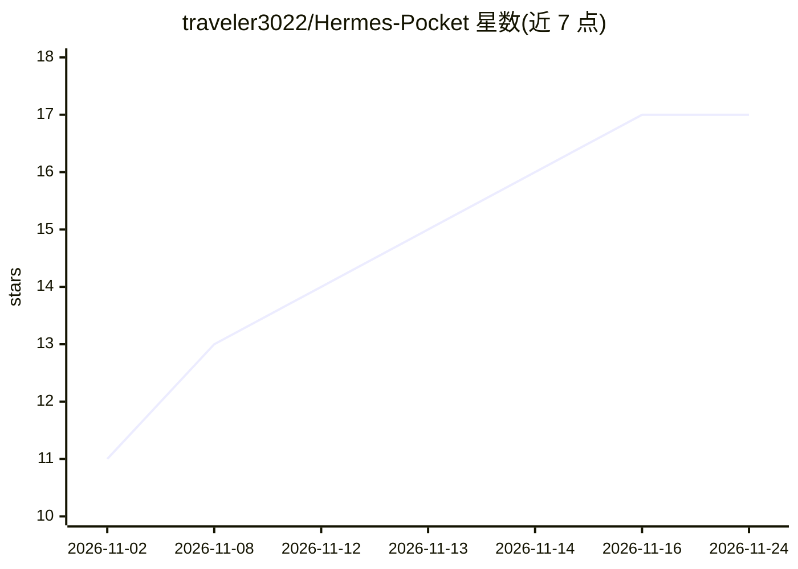

# traveler3022/Hermes-Pocket

⭐ 18 · Kotlin · GPL-3.0 · 推送 2026-11-13 · [GitHub](https://github.com/traveler3022/Hermes-Pocket) · 个人维护

**在 Android 上运行/连接 Hermes Agent 的全功能客户端**

面向终端用户的 Android 应用，用于运行 Nous Research 的开源 AI agent Hermes：可完整在手机本地运行（内置经 proot 的 Linux 系统，无需 root），或通过内置 Tailscale 连接自有服务器，或在 Termux 中运行。以官方桌面应用相同协议与 Hermes 通信，展示推理过程、工具调用、审批、文件、记忆、定时任务与 Kanban 看板；支持多模型提供商、多 agent 档案、群聊、Telegram/Discord/Slack 接入及 MCP/skills。需 Android 10+、约 1 GB 空间。独立社区项目，与 Nous Research 无隶属。

## 筛选速览

| 维度 | 判定 | 备注 |
|---|---|---|
| AI 角色 | `ai-native` | 本体是模型或模型工具 |
| 许可风险 | `viral` | GPL-3.0 |
| 部署形态 | `None` |  |
| 模型依赖 | — | README 未给出锁定关系 |
| 硬件要求 | — | 无带数字的原话,不猜 |
| 安装摩擦 | `medium` | 含编译或系统依赖之一 |
| 成熟度 | — | 结构信号不足 |

## 能力要点

- 内置 Linux（proot）在手机本地运行整个 agent，无需 root 或服务器
- 展示 agent 推理轨迹、工具调用与审批流程，支持屏幕关闭后继续运行任务
- 支持多提供商（OpenRouter、Anthropic、OpenAI、Gemini、DeepSeek 等）与任意 OpenAI 兼容端点
- 多 agent 档案、2-6 个 agent 群聊、Kanban 看板与定时任务

## 适用场景

- 在手机上直接运行 AI agent 执行 shell 命令、写代码、浏览网页
- 把 agent 放在自己的服务器上，通过手机经 Tailscale 私密访问
- 通过 Telegram/Discord/Slack 与自己的 agent 对话

## 场景标签

`AI 助手` · 领域:对话与助手

## 证据(README 行号)

> L26: **Hermes Pocket brings all of that to Android.** It isn't a chat window around an API. It talks to Hermes
> L30: And it can **host the agent itself**. The app carries a small Linux system, installs Hermes inside it, and
> L154: No. It's an independent community project and is not affiliated with Nous Research.

## 星数曲线

2026-11-02 11 → 2026-11-24 17（+6）

---
*卡片 v1 · prompt 1.4 · 生成 2026-11-18 · 置信度 high · 依据 README sha `dafc01d57b31` · [字段定义](../../DATASET.md)*
