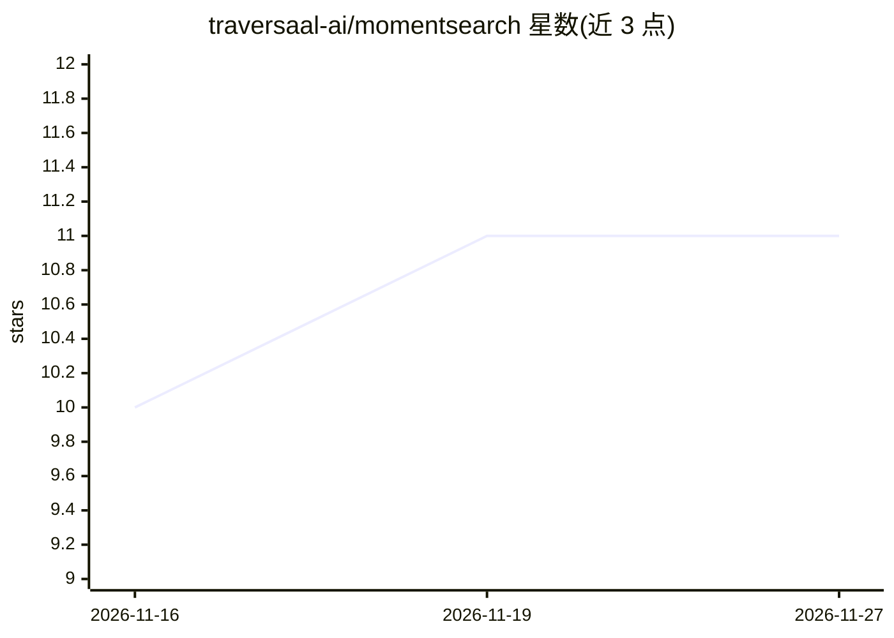

# traversaal-ai/momentsearch

⭐ 11 · Python · Apache-2.0 · 推送 2026-09-18 · [GitHub](https://github.com/traversaal-ai/momentsearch) · [官网](https://momentsearch.vercel.app/) · 组织维护

**对视频提问并返回带引用时刻的可视化检索 RAG 应用**

面向个人使用者的视频问答工具：上传视频或粘贴 YouTube 链接后，后台 worker 抽取关键帧、去重、嵌入并存入 Qdrant 向量库；提问时同时检索画面帧分支与字幕文本分支，融合排序后由视觉 LLM 阅读命中帧生成带引用的回答，证据不足时拒绝作答。每条引用附带关键帧、时间戳与 seen/said 徽标，可点击跳转到对应秒。默认预设全本地无密钥运行，LLM 与嵌入模型按 provider 名可插拔；单用户、无鉴权。

## 筛选速览

| 维度 | 判定 | 备注 |
|---|---|---|
| AI 角色 | `ai-native` | 本体是模型或模型工具 |
| 许可风险 | `permissive` | Apache-2.0 |
| 部署形态 | `desktop` | 安装包/桌面程序 |
| 模型依赖 | — | README 未给出锁定关系 |
| 硬件要求 | — | 无带数字的原话,不猜 |
| 安装摩擦 | `low` | 无编译、无系统依赖或容器化 |
| 成熟度 | — | 结构信号不足 |

## 能力要点

- 视觉帧分支与字幕分支双路检索并融合排序
- 置信门控：两路均未过阈值时不调用 LLM 直接弃答
- 每条引用可点击跳转视频对应时间点并同步字幕
- LLM/嵌入/重排/ASR 均按 provider 名配置，可全本地或全托管

## 适用场景

- 在长视频中快速定位某个问题出现画面与讲解的时刻
- 为上传的视频建立可语义搜索的索引并提问
- 要求回答附带画面与字幕出处的视频资料核查

## 场景标签

`RAG` `多模态` · 领域:知识与检索

## 证据(README 行号)

> L26: Upload videos or paste YouTube URLs. Background workers sample keyframes, dedup, embed and index them in Qdrant. As
> L31: - **Dual-branch retrieval** — a visual (frame) branch and a text (transcript) branch, fused, always both.
> L32: - **Pluggable models** — the answer LLM and both embedding branches are chosen by provider name; run fully local an

## 星数曲线

2026-11-16 10 → 2026-11-27 11（+1）

---
*卡片 v1 · prompt 1.4 · 生成 2026-11-19 · 置信度 high · 依据 README sha `74aa075a93cf` · [字段定义](../../DATASET.md)*
