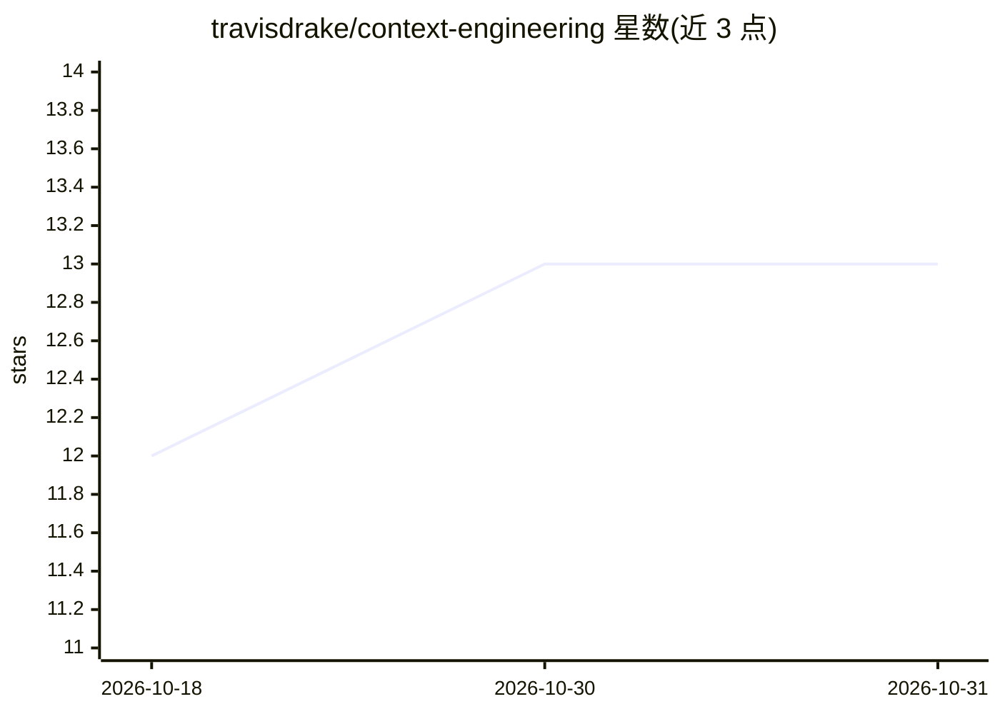

# travisdrake/context-engineering

⭐ 13 · NOASSERTION · 推送 2026-04-10 · [GitHub](https://github.com/travisdrake/context-engineering) · 个人维护

**AI agent 行为治理规则与反模式目录，供开发者直接复用**

面向运行 AI agent 做实际工作的开发者，提供行为治理框架：收录 15 个具名反模式（如 The Trailing Off、The Confident Declaration），每个对应规则置于 rules/ 目录，共 6 条独立规则、每条 200-400 词、合计约 1,500 tokens，可复制到 Cursor、Claude Code、Windsurf 等 agent 配置目录。另提供规则失效时的结构性干预示例模板（Pre-Commitment、独立评分等）。规则源于事件驱动而非理论，方法论来自 I/O 心理学，采用 CC BY 4.0 许可。

## 筛选速览

| 维度 | 判定 | 备注 |
|---|---|---|
| AI 角色 | `ai-knowledge` | 知识聚合/清单类 |
| 许可风险 | `none` | NOASSERTION |
| 部署形态 | `None` |  |
| 模型依赖 | — | README 未给出锁定关系 |
| 硬件要求 | — | 无带数字的原话,不猜 |
| 安装摩擦 | `low` | 无编译、无系统依赖或容器化 |
| 成熟度 | — | 结构信号不足 |

## 能力要点

- 15 个具名反模式目录，每个可追溯至具体事件
- 6 条独立行为治理规则（约 1,500 tokens），按目录复制进 agent 配置
- 规则失效场景下的结构性干预模板（Pre-Commitment、独立评分、非卡片布局参考）

## 适用场景

- 把治理规则复制进 Cursor/Claude Code 等编码 agent 配置
- 对照反模式目录诊断 agent 的偷工减料与虚假完成行为
- 在规则无效时改用结构性流程干预模板

## 场景标签

`提示工程` · 领域:Agent 开发

## 证据(README 行号)

> L19: **The full anti-pattern catalog** documents 15 named failure modes, each traced to a specific incident. Here are a 
> L27: Each anti-pattern has a corresponding rule. The rules are in `rules/` and are designed to be copied directly into y
> L74: Copy the six rules from `rules/` into your agent's configuration directory. See **setup.md** for tool-specific inst

## 星数曲线

2026-10-18 12 → 2026-10-31 13（+1）

---
*卡片 v1 · prompt 1.4 · 生成 2026-10-31 · 置信度 high · 依据 README sha `38c3b8b9ea75` · [字段定义](../../DATASET.md)*
