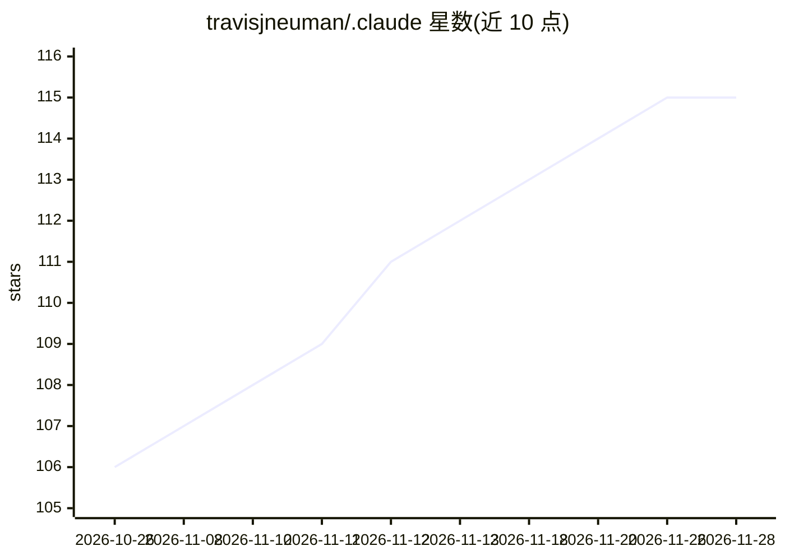

# travisjneuman/.claude

⭐ 115 · TypeScript · MIT · 推送 2026-11-19 · [GitHub](https://github.com/travisjneuman/.claude) · [官网](https://claude.travisjneuman.com) · 个人维护

**给 Claude Code 用户的即插即用技能配置包：183 技能自动路由**

面向使用 Claude Code 的开发者，提供一份可克隆到 ~/.claude/ 的配置层：183 个领域技能、10 个子代理、29 个斜杠命令、7 个生命周期 hook、17 个模板与 10 条语言规则，另含 86 个社区市场仓库（11,300+ 技能，可选安装）。机制上通过生成的 INDEX.md 与 toolkit-router 技能按需加载资源以控制上下文开销；默认以 bypassPermissions 的全权限模式运行，并由守卫 hook 拦截少量危险命令，安全模型在 SECURITY.md 中说明收紧方式。也可仅以插件形式安装技能。

## 筛选速览

| 维度 | 判定 | 备注 |
|---|---|---|
| AI 角色 | `ai-ecosystem` | LLM/agent 周边工具 |
| 许可风险 | `permissive` | MIT |
| 部署形态 | `desktop` | 安装包/桌面程序 |
| 模型依赖 | — | README 未给出锁定关系 |
| 硬件要求 | — | 无带数字的原话,不猜 |
| 安装摩擦 | `low` | 无编译、无系统依赖或容器化 |
| 成熟度 | — | 结构信号不足 |

## 能力要点

- git clone 即得 183 技能/10 代理/29 命令/7 hook 的完整配置
- 生成的 INDEX.md 与 toolkit-router 按需检索技能，降低上下文占用
- 可仅安装技能插件（tjn-skills）或按领域安装子包
- 会话起止 hook 自动 checkpoint 并推送自有仓库的待提交更改

## 适用场景

- 为 Claude Code 补充特定技术栈的领域技能与工作流
- 不想手动配置 hooks、代理与命令的开发者一键搭建 ~/.claude
- 按领域（前端/后端/数据 AI 等）只安装所需技能子包

## 场景标签

`编码 Agent` `提示工程` · 领域:Agent 开发

## 证据(README 行号)

> L19: A drop-in configuration layer for Claude Code that transforms it from a capable AI assistant into an enterprise-gra
> L21: **One `git clone` gives you** 183 domain skills, 10 specialist agents, 86 community marketplaces with 11,300+ addit
> L29: **Who it's for:** Developers who use Claude Code and want deeper domain expertise, structured workflows, and qualit

## 星数曲线

2026-10-26 106 → 2026-11-28 115（+9）

---
*卡片 v1 · prompt 1.4 · 生成 2026-11-28 · 置信度 mid · 依据 README sha `d48f4d7eaf1d` · [字段定义](../../DATASET.md)*
