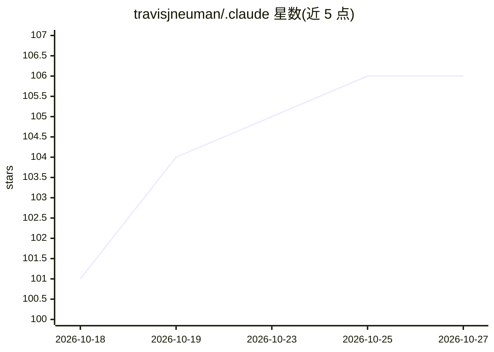

# travisjneuman/.claude

⭐ 106 · TypeScript · MIT · 推送 2026-10-26 · [GitHub](https://github.com/travisjneuman/.claude) · [官网](https://claude.travisjneuman.com) · 个人维护

**Claude Code 的即插式配置工具包：180 技能+10 agents+81 市场**

放入 ~/.claude 目录即可生效的 Claude Code 配置层：包含 180 个领域技能（Web/DevOps/安全/商业/合规等）、10 个专家子代理、29 个斜杠命令、7 个生命周期 hooks、17 个模板与 81 个社区技能市场仓库（共 11,000+ 技能）。核心机制是按需路由：每会话仅加载核心描述，其余资源通过生成的 INDEX.md 与 toolkit-router 技能按关键词检索加载，控制上下文成本。默认以 bypassPermissions 模式运行，由 guard.js 拦截危险命令，secret-scan.js 扫描凭证。面向使用 Claude Code 的开发者，git clone 即用。

## 筛选速览

| 维度 | 判定 | 备注 |
|---|---|---|
| AI 角色 | `ai-ecosystem` | LLM/agent 周边工具 |
| 许可风险 | `permissive` | MIT |
| 部署形态 | `desktop` | 安装包/桌面程序 |
| 模型依赖 | locked-api |  |
| 硬件要求 | — | 无带数字的原话,不猜 |
| 安装摩擦 | `low` | 无编译、无系统依赖或容器化 |
| 成熟度 | — | 结构信号不足 |

## 能力要点

- 180 技能 / 10 agents / 29 命令 / 7 hooks / 81 市场仓库聚合
- INDEX.md + toolkit-router 按需路由，大工具包几乎不占上下文
- guard.js 拦截危险命令、secret-scan.js 凭证扫描
- 跨平台支持（macOS/Linux/Windows Git Bash）， hooks 用 Node.js runner 解析路径

## 适用场景

- 给自己的 Claude Code 增加领域技能与专家代理而无需手工配置
- 通过关键词检索复用 11,000+ 社区技能
- 在多机上维护一致且带安全护栏的 Claude Code 工作环境

## 场景标签

`精选清单` · 领域:学习与行业

## 证据(README 行号)

> L19: A drop-in configuration layer for Claude Code that transforms it from a capable AI assistant into an enterprise-gra
> L21: **One `git clone` gives you** 180 domain skills, 10 specialist agents, 81 community marketplaces with 11,000+ addit

## 星数曲线

2026-10-18 101 → 2026-10-27 106（+5）

---
*卡片 v1 · prompt 1.4 · 生成 2026-10-23 · 置信度 high · 依据 README sha `00d59c2c2bf8` · [字段定义](../../DATASET.md)*
