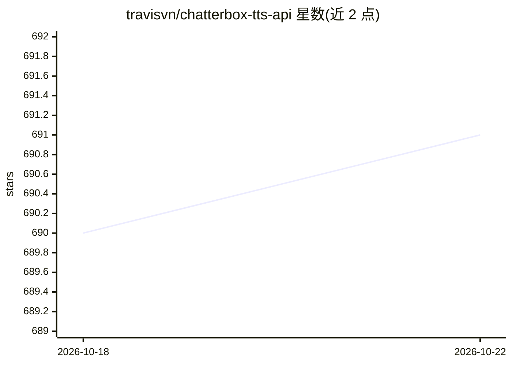

# travisvn/chatterbox-tts-api

⭐ 691 · Python · AGPL-3.0 · 推送 2025-12-23 · [GitHub](https://github.com/travisvn/chatterbox-tts-api) · [官网](https://chatterboxtts.com) · 个人维护

**给开发者的本地 Chatterbox TTS API：OpenAI 兼容接口加语音克隆**

基于 FastAPI 的本地文本转语音 API 服务，封装 chatterbox-tts 基础包，提供 OpenAI 兼容的 /v1/audio/speech 端点，可在 Open WebUI、AnythingLLM 等使用 OpenAI API 的场景中直接替换。功能包括语音克隆（上传 10-30 秒样本）、22 种语言的多语言生成、语言自动检测、语音库管理、实时流式输出（含 SSE）与进度监控。附带可选 React 前端，支持 Docker 与 GPU 部署，通过环境变量配置设备与生成参数。限制：上游 chatterbox 包当前在非 CUDA 环境存在问题，需回退 stable 分支。

## 筛选速览

| 维度 | 判定 | 备注 |
|---|---|---|
| AI 角色 | `ai-ecosystem` | LLM/agent 周边工具 |
| 许可风险 | `viral` | AGPL-3.0 |
| 部署形态 | `self-host` | docker 或自建部署 |
| 模型依赖 | — | README 未给出锁定关系 |
| 硬件要求 | — | 无带数字的原话,不猜 |
| 安装摩擦 | `low` | 无编译、无系统依赖或容器化 |
| 成熟度 | — | 结构信号不足 |

## 能力要点

- OpenAI 兼容的 TTS 端点，可直接替换 OpenAI TTS API
- 语音克隆与按名称管理的语音库（支持 22 种语言、语言自动检测）
- 实时音频流式输出（WAV 分块与 OpenAI 兼容 SSE）
- Docker 部署与可选 React Web 前端

## 适用场景

- 给 Open WebUI / AnythingLLM 等本地应用接上 TTS 能力
- 用自己的声音样本批量生成克隆语音
- 为应用提供低延迟流式语音合成服务

## 场景标签

 · 领域:语音合成/LLM 基础设施

## 证据(README 行号)

> L16: **FastAPI**-powered REST API for Chatterbox TTS, providing OpenAI-compatible text-to-speech endpoints with voice cl
> L20: 🚀 **OpenAI-Compatible API** - Drop-in replacement for OpenAI's TTS API

## 星数曲线

2026-10-18 690 → 2026-10-22 691（+1）

---
*卡片 v1 · prompt 1.4 · 生成 2026-10-21 · 置信度 mid · 依据 README sha `0b4b0ea59f5a` · [字段定义](../../DATASET.md)*
