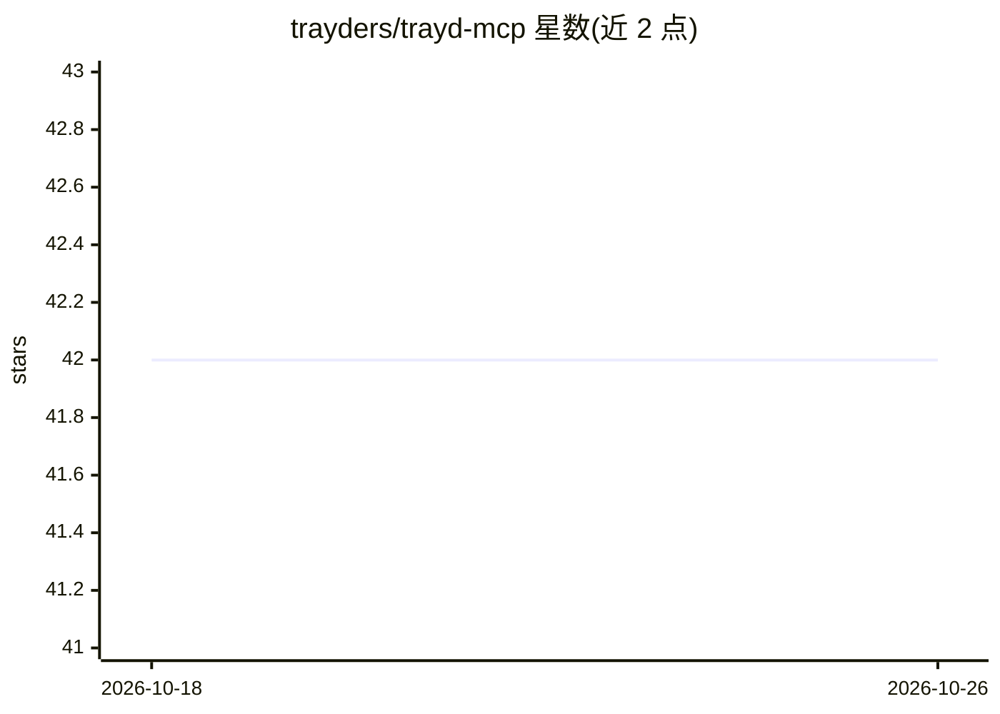

# trayders/trayd-mcp

⭐ 42 · 推送 2026-06-26 · [GitHub](https://github.com/trayders/trayd-mcp) · 组织维护

**通过 Claude 交易 Robinhood 的远程 MCP 服务器**

托管的远程 MCP 服务器，将 Claude（claude.ai 网页版与 Claude Code）接入 Robinhood 账户：支持组合分析、实时/盘后报价、买卖、限价单、阶梯单、做空、批量下单、多账户管理与撤单。本地无需安装 Python、Docker 或 API key，通过浏览器添加自定义连接器或一条 claude mcp add 命令接入。另提供跨会话持久化记忆 wiki，可配合 Claude Code 的 /loop 命令运行基于自然语言规则的定时交易代理。凭据直传 Robinhood API、不落盘，MCP 认证采用 OAuth 2.1 with PKCE。

## 筛选速览

| 维度 | 判定 | 备注 |
|---|---|---|
| AI 角色 | `ai-ecosystem` | LLM/agent 周边工具 |
| 许可风险 | `none` | — |
| 部署形态 | `None` |  |
| 模型依赖 | locked-api |  |
| 硬件要求 | — | 无带数字的原话,不猜 |
| 安装摩擦 | `low` | 无编译、无系统依赖或容器化 |
| 成熟度 | — | 结构信号不足 |

## 能力要点

- 远程托管 MCP 服务器，本地零安装（无 Python/Docker/API key）
- 支持买卖、限价、阶梯、做空、批量、多账户等完整交易能力
- 24/7 双源报价（盘后自动切换合作行情源）
- 跨会话持久化私有 wiki 记忆与 /loop 定时交易代理

## 适用场景

- 用自然语言查询持仓并下达买卖指令
- 设置阶梯限价单、批量下单与定时监控规则
- 在多个 Robinhood 账户间切换管理

## 场景标签

`金融量化` · 领域:学习与行业

## 证据(README 行号)

> L3: Trade Robinhood from Claude. Portfolio analysis, real-time quotes, and order execution through natural language.
> L32: claude mcp add --transport http trayd https://mcp.trayd.ai/mcp --scope user
> L65: - **Remote server** — nothing to install, no Python, no Docker, no API keys

## 星数曲线

2026-10-18 42 → 2026-10-26 42（+0）

---
*卡片 v1 · prompt 1.4 · 生成 2026-10-25 · 置信度 high · 依据 README sha `136c2d5fd60f` · [字段定义](../../DATASET.md)*
