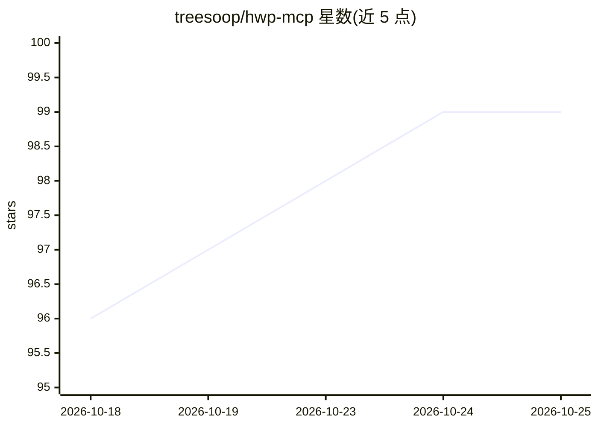

# treesoop/hwp-mcp

⭐ 99 · TypeScript · MIT · 推送 2026-07-08 · [GitHub](https://github.com/treesoop/hwp-mcp) · [官网](https://github.com/treesoop/hwp-mcp) · 个人维护 · 中文 README

**让 MCP 兼容 AI 读写韩文 HWP/HWPX 文档的 MCP 服务器**

构建于 rhwp（Rust+WebAssembly 韩文文档引擎）之上的 MCP 服务器，向 Claude/Cursor/ChatGPT 等 MCP 客户端暴露 35 个工具：读取 .hwp/.hwpx 正文、表格、图片、页眉页脚、脚注，转 Markdown，渲染页面为 SVG/HTML；写入仅支持 .hwpx（查找替换、模板占位符填充、新建文档、段落/表格行列/单元格编辑、样式与图片操作），通过 ZIP 级 XML 变更绕过 rhwp 导出限制。WebAssembly 引擎使其在 macOS/Windows/Linux 上运行且无需安装韩文办公软件。需 Node.js 20 以上。

## 筛选速览

| 维度 | 判定 | 备注 |
|---|---|---|
| AI 角色 | `ai-ecosystem` | LLM/agent 周边工具 |
| 许可风险 | `permissive` | MIT |
| 部署形态 | `library` | 以包/库形式分发 |
| 模型依赖 | — | README 未给出锁定关系 |
| 硬件要求 | — | 无带数字的原话,不猜 |
| 安装摩擦 | `low` | 无编译、无系统依赖或容器化 |
| 成熟度 | `idea` | |

## 能力要点

- 35 个 MCP 工具：读取/转换/渲染 .hwp 与 .hwpx，写入仅 .hwpx
- WebAssembly 引擎跨平台运行，无需安装 Hancom Office
- 绕过 rhwp exportHwpx 限制的 .hwpx ZIP 级写入层
- HWP/HWPX → Markdown 转换（表格/图片/公式/脚注处理）

## 适用场景

- 让 Claude/Cursor 读取韩国政府 HWP 文档并转换 Markdown
- 用 AI 填充 HWPX 模板的占位符生成文档
- 批量替换 HWPX 文档文本或提取内嵌图片

## 场景标签

`文档解析` · 领域:知识与检索

## 证据(README 行号)

> L12: `hwp-mcp`은 한컴오피스 문서를 AI 에이전트가 직접 다루도록 해주는 MCP(Model Context Protocol) 서버입니다. **읽기뿐 아니라 텍스트 수정, 템플릿 채우기, 새 문서 생성까지 가
> L22: - 🤝 **`hwp-mcp` 가 한 일 (에이전트 어댑터)** — `@rhwp/core` 위에 얹은 MCP 서버 layer. 우리가 추가한 것은:

## 星数曲线

2026-10-18 96 → 2026-10-25 99（+3）

---
*卡片 v1 · prompt 1.4 · 生成 2026-10-23 · 置信度 high · 依据 README sha `0856fc1304fd` · [字段定义](../../DATASET.md)*
