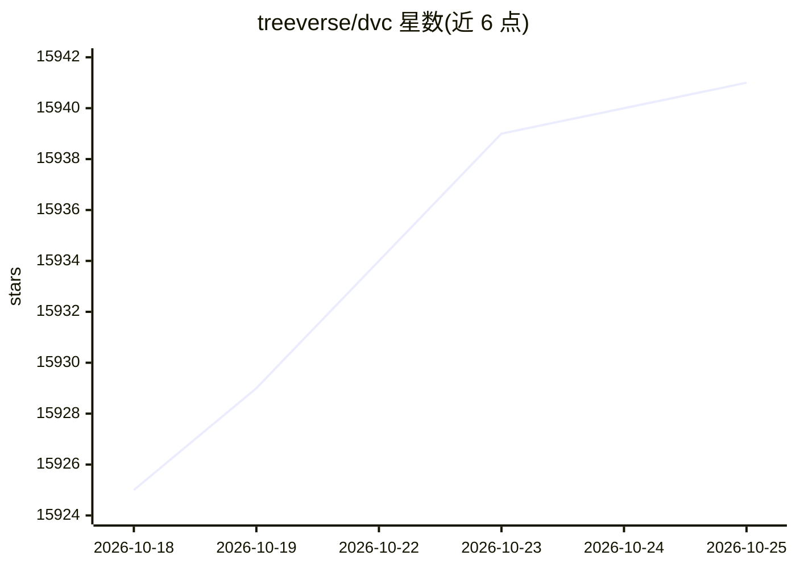

# treeverse/dvc

⭐ 15,941 · Python · Apache-2.0 · 推送 2026-10-19 · [GitHub](https://github.com/treeverse/dvc) · [官网](https://dvc.org) · 组织维护

**给 ML 团队的开源数据与模型版本控制及实验管理工具**

DVC 是一个命令行工具（配套 VS Code 扩展），通过在 Git 仓库中保存数据/模型的版本元信息，将实际文件存储在 Git 之外的缓存或云存储中，实现 ML 项目的可复现开发。功能覆盖数据与模型版本管理、轻量级 pipeline 定义与增量执行、本地实验跟踪与对比、远程数据共享与协作复现。支持 S3、Azure、Google Cloud、SSH 等远程存储，按存储类型可选安装 dvc-s3、dvc-azure 等附加依赖。以 Apache 2.0 许可分发。

## 筛选速览

| 维度 | 判定 | 备注 |
|---|---|---|
| AI 角色 | `ai-ecosystem` | LLM/agent 周边工具 |
| 许可风险 | `permissive` | Apache-2.0 |
| 部署形态 | `desktop` | 安装包/桌面程序 |
| 模型依赖 | — | README 未给出锁定关系 |
| 硬件要求 | — | 无带数字的原话,不猜 |
| 安装摩擦 | `low` | 无编译、无系统依赖或容器化 |
| 成熟度 | — | 结构信号不足 |

## 动量与使用信号

- 维护:`active` — 距上次 push 5.6 天,年发版 8,292 位贡献者
- 涨星:近 1 天 **+0**(自 20261016 起算)
- 安装:pypi 包 `dvc` 月下载 1,631,891

## 能力要点

- 数据/模型版本元信息入 Git，文件本体存 Git 外缓存或云存储
- pipeline 计算图只重跑受变更影响的步骤
- 本地实验跟踪，可按超参数和指标过滤、比较并绘图
- VS Code 扩展提供 GUI（实验跟踪与数据管理）

## 适用场景

- 给训练数据和模型文件做版本管理而不塞进 Git 仓库
- 跟踪和比较多轮实验的参数、指标与图表
- 把数据/模型推到 S3 等远程存储并复现他人实验

## 场景标签

`MLOps` · 领域:训练与推理

## 证据(README 行号)

> L20: **Data Version Control** or **DVC** is a command line tool and `VS Code Extension`_ to help you develop reproducibl
> L72: #. **Git for data**: Store and share data artifacts (like Git-LFS but without a server) and models, connecting them
> L143: Depending on the remote storage type you plan to use to keep and share your data, you might need to install option

## 星数曲线

2026-10-18 15,925 → 2026-10-25 15,941（+16）

---
*卡片 v1 · prompt 1.4 · 生成 2026-10-18 · 置信度 high · 依据 README sha `0a0f05b1da9b` · [字段定义](../../DATASET.md)*
