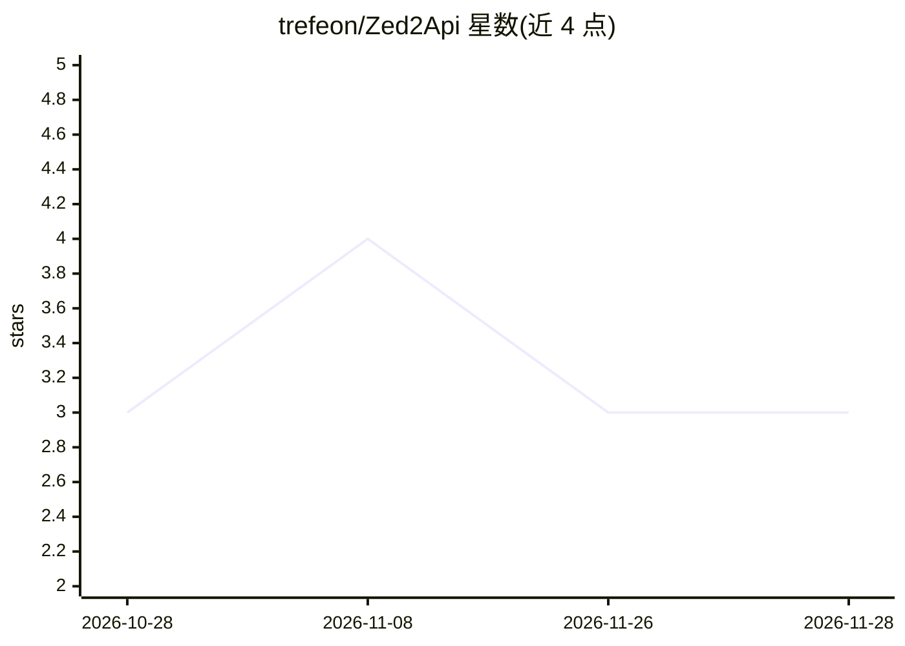

# trefeon/Zed2Api

⭐ 3 · TypeScript · MIT · 推送 2026-11-01 · [GitHub](https://github.com/trefeon/Zed2Api) · 个人维护

**让 PI/OMP 把 Zed 订阅当原生模型提供方使用的插件**

面向 PI 与 OMP 两个宿主的扩展插件：注册一个 `zed` provider，模型目录取自已连接的 Zed 账户，账户存储、登录、token 刷新、请求转换、流式输出、工具调用与用量记账均在扩展内完成，不涉及网关进程。按模型 id 自动选择 Anthropic/OpenAI/Google/xAI 的请求方言并支持 reasoning 档位；提供 `/zed` 系列命令管理多账户、刷新目录与统计本地用量。需拥有 hosted-model 访问权限的 Zed 账户（Pro/Student/Business），且与 Zed Industries 无隶属关系。

## 筛选速览

| 维度 | 判定 | 备注 |
|---|---|---|
| AI 角色 | `ai-ecosystem` | LLM/agent 周边工具 |
| 许可风险 | `permissive` | MIT |
| 部署形态 | `None` |  |
| 模型依赖 | — | README 未给出锁定关系 |
| 硬件要求 | — | 无带数字的原话,不猜 |
| 安装摩擦 | `low` | 无编译、无系统依赖或容器化 |
| 成熟度 | — | 结构信号不足 |

## 能力要点

- 注册 `zed` provider，模型目录实时来自已连接 Zed 账户
- 按模型 id 自动选择 Messages/Responses/Gemini/Chat Completions 请求方言
- 支持多账户登录、切换、probe 与本地 token 用量记账（不存提示词与响应文本）
- npm 安装后具备每小时检查一次的自升级机制

## 适用场景

- 已有 Zed Pro/Student/Business 订阅，想在 PI 或 OMP 中直接调用其托管模型
- 在同一宿主中管理多个 Zed 账户并切换使用
- 本地统计各模型的 token 消耗与费用

## 场景标签

`模型网关` · 领域:Agent 开发

## 证据(README 行号)

> L3: Use a **Zed subscription** as a native model provider in
> L7: The extension registers a `zed` provider whose model catalog comes from the
> L9: request conversion, streaming, tool calls, and usage accounting all run inside

## 星数曲线

2026-10-28 3 → 2026-11-28 3（+0）

---
*卡片 v1 · prompt 1.4 · 生成 2026-11-21 · 置信度 high · 依据 README sha `26eb4c34bafe` · [字段定义](../../DATASET.md)*
