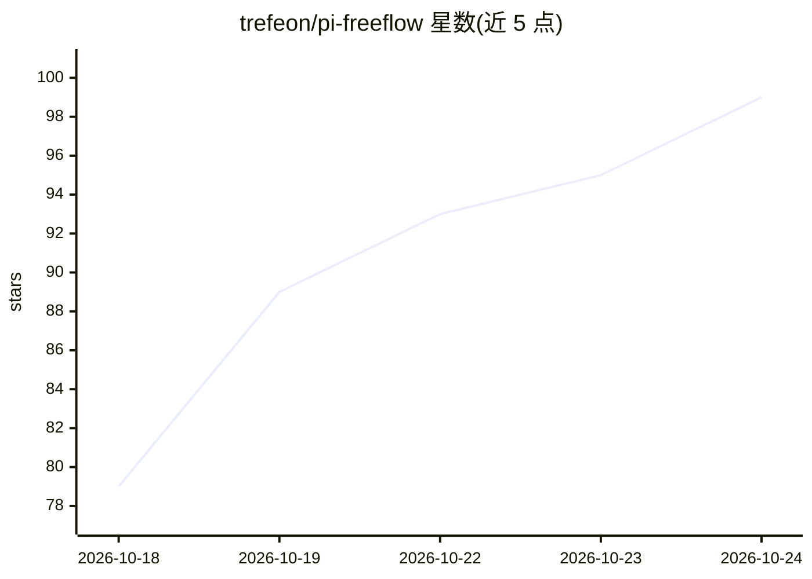

# trefeon/pi-freeflow

⭐ 99 · TypeScript · MIT · 推送 2026-10-23 · [GitHub](https://github.com/trefeon/pi-freeflow) · [官网](https://pi.dev/packages/pi-freeflow) · 个人维护

**为 Pi/Oh My Pi 提供 37 个免费模型与中继代理的插件**

作为 Oh My Pi 与 Pi 编码 agent 的扩展插件运行，聚合来自 OpenCode Zen、KiloCode Gateway、Cline、OVHcloud 的 37 个免费模型（上下文最高 1M），统一为短名模型 ID 供 /model 选择。核心机制包括：可自建的请求中继池（自托管 WARP 池、Cloudflare Workers/Deno Deploy/Vercel Edge），在多出口 IP 间分摊请求以规避按 IP 计的免费层限流；中继故障时自动冷却并回退直连上游。附带本地回环共享代理、轮转日志与工具调用诊断（JSONL）。限制：仅在 OMP/Pi 宿主内加载，非独立 CLI；模型目录仅文本与图像输入。

## 筛选速览

| 维度 | 判定 | 备注 |
|---|---|---|
| AI 角色 | `ai-ecosystem` | LLM/agent 周边工具 |
| 许可风险 | `permissive` | MIT |
| 部署形态 | `library` | 以包/库形式分发 |
| 模型依赖 | — | README 未给出锁定关系 |
| 硬件要求 | — | 无带数字的原话,不猜 |
| 安装摩擦 | `low` | 无编译、无系统依赖或容器化 |
| 成熟度 | — | 结构信号不足 |

## 能力要点

- 聚合 4 个免费来源共 37 个模型，上下文窗口最高 1M
- 自建中继池分散请求到多个出口 IP，含冷却与自动直连回退
- 一条 JSONL 记录每个声明工具的流式轮次的调用、参数规模与失败分类
- 中继池可导出/导入 JSON 在多机间迁移

## 适用场景

- 在免费层配额内跑长上下文编码与 agent 任务
- 多出口 IP 中继池分摊请求，规避按 IP 的限流
- 跨会话/子代理复用同一本地代理与中继池

## 场景标签

 · 领域:LLM 基础设施/编码 agent 工具

## 证据(README 行号)

> L3: > 37 free models with up to 1M context. No API keys to manage. Add your own relays to spread requests across more IP
> L5: Thin by design: a model list, a relay proxy, and a log. The host (`pi-ai`) handles thinking, normalization, and prov
> L17: |**37 free models**|12 from OpenCode Zen, 16 from KiloCode Gateway, 1 from Cline, 8 from OVHcloud AI Endpoints, con

## 星数曲线

2026-10-18 79 → 2026-10-24 99（+20）

---
*卡片 v1 · prompt 1.4 · 生成 2026-10-23 · 置信度 high · 依据 README sha `adeb07333929` · [字段定义](../../DATASET.md)*
