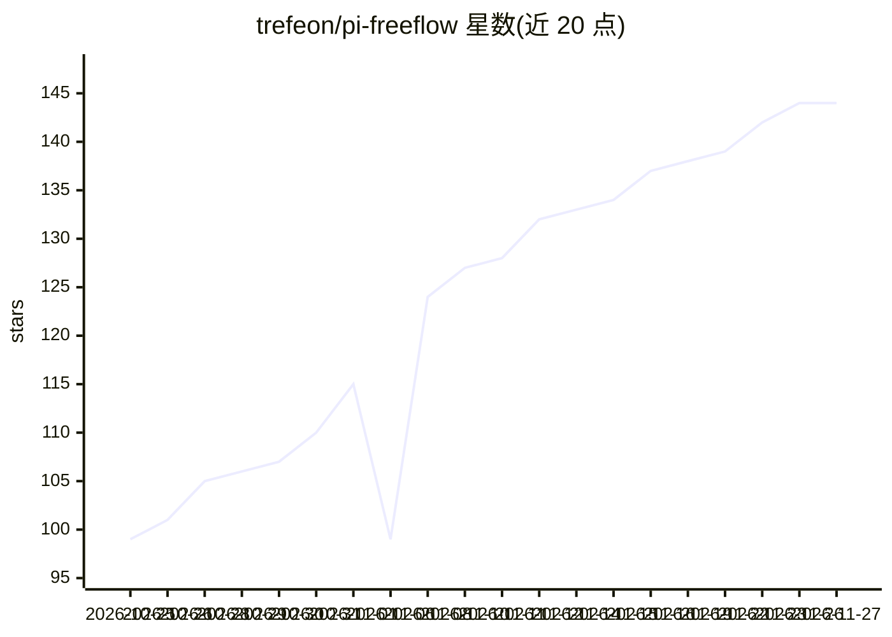

# trefeon/pi-freeflow

⭐ 144 · TypeScript · MIT · 推送 2026-11-26 · [GitHub](https://github.com/trefeon/pi-freeflow) · [官网](https://pi.dev/packages/pi-freeflow) · 个人维护

**为 Pi/OMP 编码代理聚合 32 个免费模型并提供中继代理**

作为 Pi 与 Oh My Pi 宿主的扩展插件运行，提供经过核验的免费模型清单（含动态发现的 Kilo 模型，上下文最高 1M）、自建中继代理池（WARP 池/Cloudflare Workers/Deno Deploy/Vercel Edge）以分散出口 IP 应对免费额度限流、自动回退、共享本地代理（127.0.0.1:28180）、可读日志与工具调用诊断。MIT 许可，非独立 CLI，仅支持 OMP 与 Pi 宿主。

## 筛选速览

| 维度 | 判定 | 备注 |
|---|---|---|
| AI 角色 | `ai-ecosystem` | LLM/agent 周边工具 |
| 许可风险 | `permissive` | MIT |
| 部署形态 | `library` | 以包/库形式分发 |
| 模型依赖 | — | README 未给出锁定关系 |
| 硬件要求 | — | 无带数字的原话,不猜 |
| 安装摩擦 | `low` | 无编译、无系统依赖或容器化 |
| 成熟度 | — | 结构信号不足 |

## 能力要点

- 32 个经核验的免费模型，上下文窗口最高 1M
- 中继代理池分散出口 IP，限流节点自动冷却轮换
- 共享本地代理与 token 门控，供并行子代理复用
- 工具调用诊断日志（toolcall-audit.jsonl）记录参数规模与失败分类

## 适用场景

- 在 Pi/OMP 中使用免费模型跑长编码与代理任务
- 出口 IP 被免费额度限流时通过自建中继分散请求
- 排查模型工具调用失败的原因与参数问题

## 场景标签

`模型网关` · 领域:Agent 开发

## 证据(README 行号)

> L5: Thin by design: a model list, a relay proxy, and a log. The host (`pi-ai`) handles thinking, normalization, and prov
> L17: |**Relay pool**|Route requests through your own relays: a self-hosted egress pool (many egress IPs on one small hos
> L49: > pi-freeflow is an extension loaded by the host, not a standalone CLI; it works

## 星数曲线

2026-10-25 99 → 2026-11-27 144（+45）

---
*卡片 v1 · prompt 1.4 · 生成 2026-11-27 · 置信度 high · 依据 README sha `5f9f4c521d77` · [字段定义](../../DATASET.md)*
