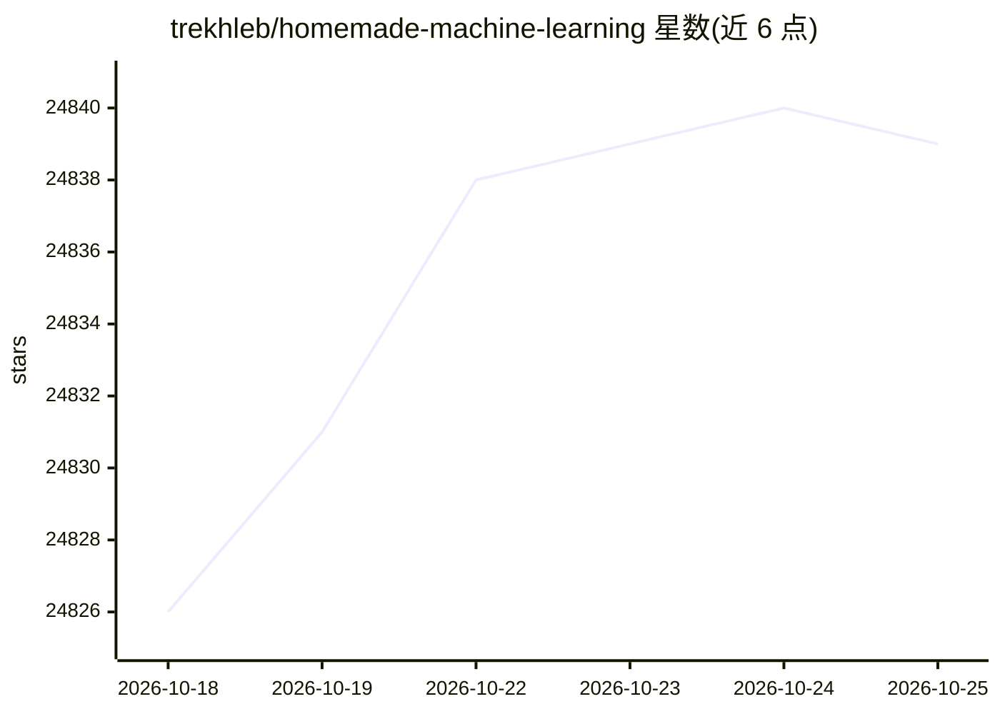

# trekhleb/homemade-machine-learning

⭐ 24,841 · Jupyter Notebook · MIT · 推送 2025-11-23 · [GitHub](https://github.com/trekhleb/homemade-machine-learning) · 个人维护

**为学习者提供从零实现的经典机器学习算法示例与交互演示**

该仓库以 Python 从零实现流行机器学习算法，每个算法附数学原理讲解与交互式 Jupyter Notebook 演示，可在浏览器中调整训练数据与算法配置并查看结果、图表与预测。内容覆盖监督学习（线性/逻辑回归）、无监督学习（K-means、高斯异常检测）与多层感知机，讲解多基于 Andrew Ng 的机器学习课程。作者明确声明这些实现不用于生产环境。

## 筛选速览

| 维度 | 判定 | 备注 |
|---|---|---|
| AI 角色 | `ai-knowledge` | 知识聚合/清单类 |
| 许可风险 | `permissive` | MIT |
| 部署形态 | `library` | 以包/库形式分发 |
| 模型依赖 | — | README 未给出锁定关系 |
| 硬件要求 | — | 无带数字的原话,不猜 |
| 安装摩擦 | `low` | 无编译、无系统依赖或容器化 |
| 成熟度 | — | 结构信号不足 |

## 动量与使用信号

- 维护:`declining` — 距上次 push 329.2 天,年发版 0,3 位贡献者
- 涨星:近 1 天 **+5**(自 20261016 起算)

## 能力要点

- 从零实现算法并配数学原理讲解，基于 Andrew Ng 课程
- 每个算法提供交互式 Jupyter Notebook 演示，浏览器内即可运行
- 覆盖回归、分类、聚类、异常检测与多层感知机
- 提供 NBViewer 在线预览与 Binder 在线执行入口

## 适用场景

- 学习机器学习算法背后的数学原理
- 通过交互演示调参并观察模型预测结果
- 阅读从零实现来理解算法内部机制

## 场景标签

`教程课程` · 领域:学习与行业

## 证据(README 行号)

> L22: > This repository contains examples of popular machine learning algorithms implemented in **Python** with mathemati
> L24: The purpose of this repository is _not_ to implement machine learning algorithms by using 3 rd party library one-li

## 星数曲线

2026-10-18 24,826 → 2026-10-25 24,839（+13）

---
*卡片 v1 · prompt 1.4 · 生成 2026-10-18 · 置信度 high · 依据 README sha `a4cb237cac96` · [字段定义](../../DATASET.md)*
