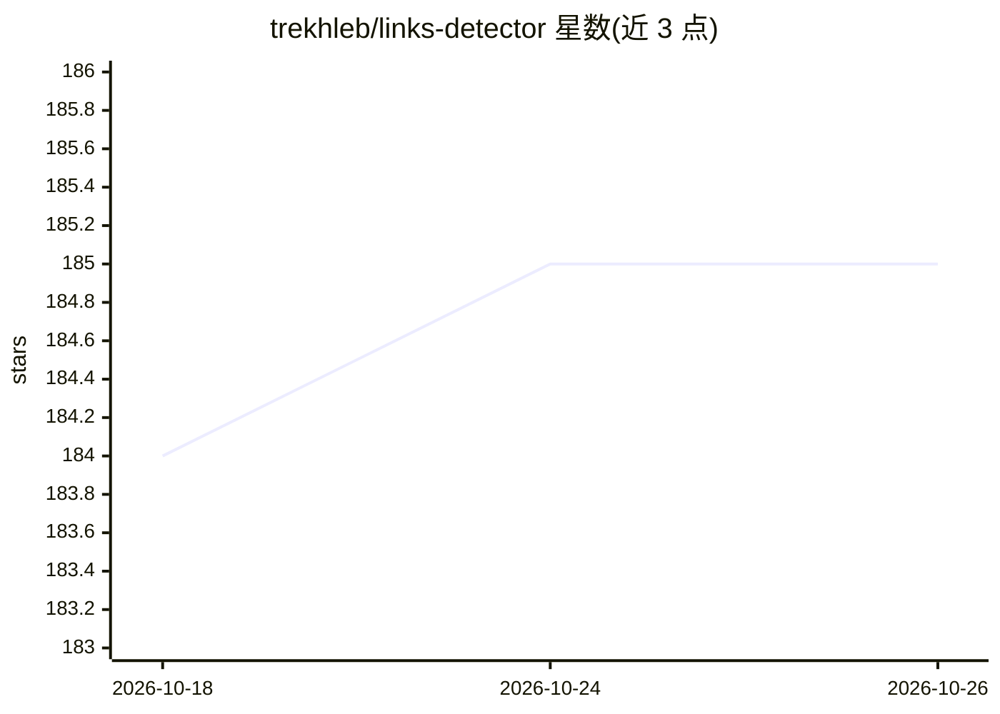

# trekhleb/links-detector

⭐ 185 · TypeScript · MIT · 推送 2025-11-23 · [GitHub](https://github.com/trekhleb/links-detector) · [官网](https://trekhleb.dev/links-detector/) · 个人维护

**用手机摄像头识别印刷链接并转为可点击的 Web 应用**

纯前端 React（TypeScript）PWA 应用：通过智能手机摄像头检测书籍杂志上印刷的 URL，经识别后转为可点击链接，无需手动逐字输入。检测模型由 TensorFlow 2 Object Detection API 训练；识别在浏览器端完成，由 TensorFlow 与 Tesseract.js 实现，依赖 WebGL 与 WebAssembly，不向服务器发送图像。基于 Workbox 实现资源缓存与离线可用。README 声明应用处于实验性 Alpha 阶段，存在较多问题与限制。

## 筛选速览

| 维度 | 判定 | 备注 |
|---|---|---|
| AI 角色 | `ai-native` | 本体是模型或模型工具 |
| 许可风险 | `permissive` | MIT |
| 部署形态 | `None` |  |
| 模型依赖 | — | README 未给出锁定关系 |
| 硬件要求 | — | 无带数字的原话,不猜 |
| 安装摩擦 | `low` | 无编译、无系统依赖或容器化 |
| 成熟度 | `idea` | |

## 能力要点

- 摄像头检测并识别印刷链接，转为一次点击
- 纯前端推理，图像不发送服务器，依赖 WebGL/WebAssembly
- 检测模型由 TensorFlow 2 Object Detection API 训练
- PWA 支持，可离线缓存并安装为独立应用

## 适用场景

- 读书看杂志时不想逐字输入印刷链接，扫一下直接访问
- 把纸质资料上的 URL 快速转到手机浏览器

## 场景标签

`目标检测` `OCR` · 领域:感知与多模态

## 证据(README 行号)

> L17: Similarly to QR-code detection, we may try to "teach" the smartphone to _detect_ and _recognize_ printed links for 
> L39: Links detection and recognition happens by means of TensorFlow and Tesseract.js libraries which in turn rely on Web

## 星数曲线

2026-10-18 184 → 2026-10-26 185（+1）

---
*卡片 v1 · prompt 1.4 · 生成 2026-10-22 · 置信度 high · 依据 README sha `bb0bcb99668a` · [字段定义](../../DATASET.md)*
