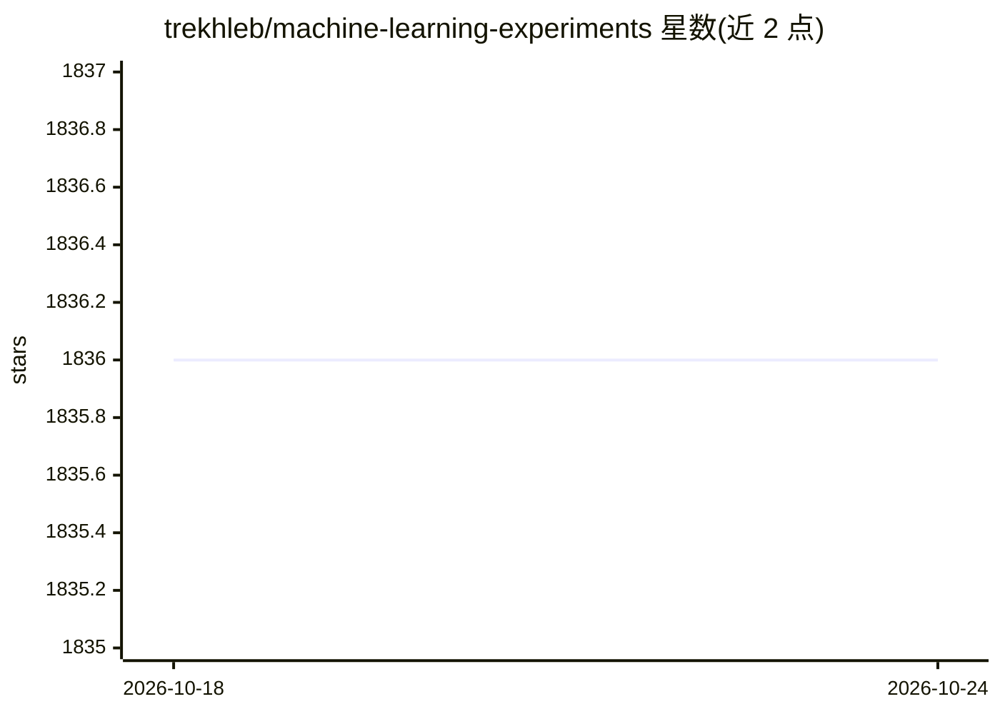

# trekhleb/machine-learning-experiments

⭐ 1,836 · Jupyter Notebook · MIT · 推送 2025-11-23 · [GitHub](https://github.com/trekhleb/machine-learning-experiments) · [官网](https://trekhleb.dev/machine-learning-experiments/) · 个人维护

**交互式机器学习实验集：Jupyter 训练笔记本 + 浏览器演示**

由个人维护的机器学习实验合集，每个实验包含一个展示模型训练过程的 Jupyter/Colab 笔记本和一个可在浏览器中运行的演示页面。实验覆盖 MLP 手写数字/草图识别、CNN 图像分类与物体检测、MobileNetV2 迁移学习、RNN/LSTM 的数字求和与文本生成（莎士比亚/维基百科/菜谱）等。模型多用 TensorFlow 2 与 Keras 训练。README 明确声明这是学习用沙盒而非生产级代码，模型可能存在欠拟合/过拟合问题。

## 筛选速览

| 维度 | 判定 | 备注 |
|---|---|---|
| AI 角色 | `ai-knowledge` | 知识聚合/清单类 |
| 许可风险 | `permissive` | MIT |
| 部署形态 | `library` | 以包/库形式分发 |
| 模型依赖 | — | README 未给出锁定关系 |
| 硬件要求 | — | 无带数字的原话,不猜 |
| 安装摩擦 | `low` | 无编译、无系统依赖或容器化 |
| 成熟度 | `idea` | |

## 能力要点

- 每个实验配 Jupyter/Colab 训练笔记本与浏览器演示页
- 覆盖 MLP/CNN/RNN/LSTM、迁移学习、物体检测、文本生成
- 模型主要使用 TensorFlow 2 + Keras 训练
- README 自声明为实验沙盒，非生产就绪代码

## 适用场景

- 学习不同机器学习方法的训练过程
- 在浏览器中直接体验训练好的模型
- 在 Colab/Binder 中在线运行与修改实验笔记本

## 场景标签

 · 领域:机器学习/教育

## 证据(README 行号)

> L12: This is a collection of interactive machine-learning experiments. Each experiment consists of 🏋️ Jupyter/Colab _not
> L19: > ⚠️ This repository contains machine learning **experiments** and **not** a production ready, reusable, optimised 
> L23: Most of the models in these experiments were trained using TensorFlow 2 with Keras support.

## 星数曲线

2026-10-18 1,836 → 2026-10-24 1,836（+0）

---
*卡片 v1 · prompt 1.4 · 生成 2026-10-21 · 置信度 mid · 依据 README sha `c83aeebdee82` · [字段定义](../../DATASET.md)*
