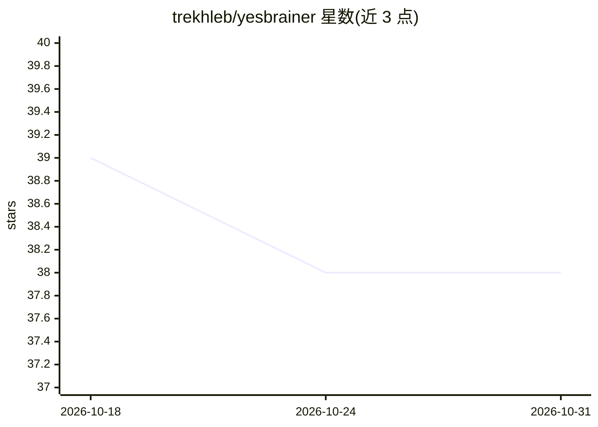

# trekhleb/yesbrainer

⭐ 38 · HTML · AGPL-3.0 · 推送 2026-10-11 · [GitHub](https://github.com/trekhleb/yesbrainer) · [官网](https://yesbrainer.ai) · 个人维护

**浏览器端多模型议事应用：一个问题并发多模型辩论出共识或裁决**

零后端的纯浏览器 PWA：用户自带 API key，将同一问题扇出给多个 LLM，提供三种议事结构——Parallel（独立作答无综合）、Trial（匿名互评+Judge 裁决）、Consensus（多轮匿名辩论由 Mediator 促收敛）。支持 Anthropic、OpenAI、Google、Groq、OpenRouter 及可选 Ollama 组成同一议会。密钥存 localStorage、会话存 IndexedDB，无服务器、无账号；官方站部署为静态包，仅含一个无 cookie 的自托管页面计数。限制：无跨设备同步、无重置流程，浏览器可能回收存储；Consensus 模式调用开销约为参与模型数×轮数。

## 筛选速览

| 维度 | 判定 | 备注 |
|---|---|---|
| AI 角色 | `ai-native` | 本体是模型或模型工具 |
| 许可风险 | `viral` | AGPL-3.0 |
| 部署形态 | `library` | 以包/库形式分发 |
| 模型依赖 | local-ok | 支持本地模型 |
| 硬件要求 | — | 无带数字的原话,不猜 |
| 安装摩擦 | `low` | 无编译、无系统依赖或容器化 |
| 成熟度 | — | 结构信号不足 |

## 能力要点

- 三种议事结构：并行作答/匿名互评+Judge 裁决/多轮共识辩论
- 纯浏览器静态包，零后端零账号，BYOK 直连各模型提供商
- 密钥存 localStorage、会话存 IndexedDB，无服务端留存
- 可安装为 PWA，多轮会话，附无需 key 的录演示议会

## 适用场景

- 对重要决策征询多个模型的独立意见并查看分歧
- 多模型匿名互评与 Judge 综合得出单一裁决
- 在手机上以一个界面替代多标签页反复粘贴同一提问

## 场景标签

`多智能体` · 领域:Agent 开发

## 证据(README 行号)

> L5:  Yes-Brainer — a council of AI models for the decisions that aren’t no-brainers. One question fans out to several mo
> L9: > **Yes-Brainer — a council of AI models for the decisions that aren’t no-brainers.** Ask several AI models one ques
> L15: - **Different model providers supported** — Anthropic, OpenAI, Google, Groq, OpenRouter, opt-in Ollama — in one cou

## 星数曲线

2026-10-18 39 → 2026-10-31 38（-1）

---
*卡片 v1 · prompt 1.4 · 生成 2026-10-25 · 置信度 high · 依据 README sha `d920f3c886cb` · [字段定义](../../DATASET.md)*
