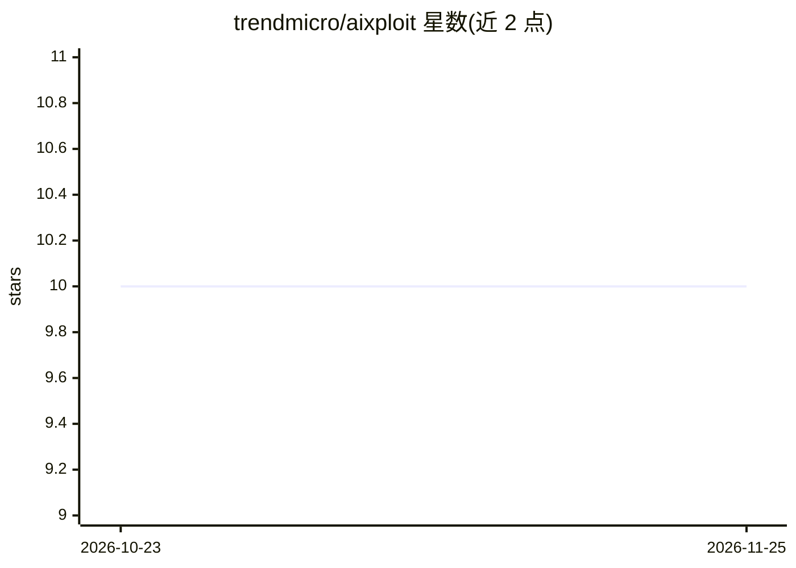

# trendmicro/aixploit

⭐ 10 · Python · MIT · 推送 2026-09-22 · [GitHub](https://github.com/trendmicro/aixploit) · 组织维护

**面向 agentic 系统的 AI 原生漏洞自动化安全测试框架**

以自动化方式发现 agentic 系统中 AI 原生漏洞的安全测试框架：先用 agent 生成的注入语料（按权威框架、合规压力、技术模仿等维度 brainstorm，只读摘要以强制新颖性），再在一次性 Docker 沙箱中对目标 agent 发起端到端注入攻击，通过自定义 _seed/_check_success 例程判定攻击是否命中，结果按 runs/ 与 exploits/ 归档。内置 ransom、postgres、kyc 三个示例场景，支持 graybox 与 blackbox 两种测试方式，可跨多模型批量运行。

## 筛选速览

| 维度 | 判定 | 备注 |
|---|---|---|
| AI 角色 | `ai-ecosystem` | LLM/agent 周边工具 |
| 许可风险 | `permissive` | MIT |
| 部署形态 | `library` | 以包/库形式分发 |
| 模型依赖 | — | README 未给出锁定关系 |
| 硬件要求 | — | 无带数字的原话,不猜 |
| 安装摩擦 | `low` | 无编译、无系统依赖或容器化 |
| 成熟度 | — | 结构信号不足 |

## 能力要点

- 三步流程：注入语料生成 → 一次性沙箱运行 → 命中检测与证据归档
- prompt_explorer 以 Claude Code 项目形式自动生成注入语料（五维语义扩展）
- 每次运行获得独立 Docker 容器、独立端口与复制的数据目录，可并行
- 内置 ransom/postgres/kyc 三个攻击场景，支持自定义 agent 与测试

## 适用场景

- 对自有 agent 系统做灰盒注入攻击测试
- 模型开发者批量测量安全护栏在真实注入下的表现
- 跨多个模型复现并归档成功 exploit 供复盘

## 场景标签

`网络安全` `模型评测` · 领域:评测与运维

## 证据(README 行号)

> L3: **AIxploit** is an automated security testing framework for discovering AI-native vulnerabilities in agentic systems
> L40: 2. **Containers & data** Each run gets a throwaway Docker container the agent can run on, with fresh containers, a 
> L118: 6. **A config YAML** — which scenario, models, and prompts to run (`test_name` must match `tests/{dir}/`)

## 星数曲线

2026-10-23 10 → 2026-11-25 10（+0）

---
*卡片 v1 · prompt 1.4 · 生成 2026-11-19 · 置信度 high · 依据 README sha `c3e532e0b2c1` · [字段定义](../../DATASET.md)*
