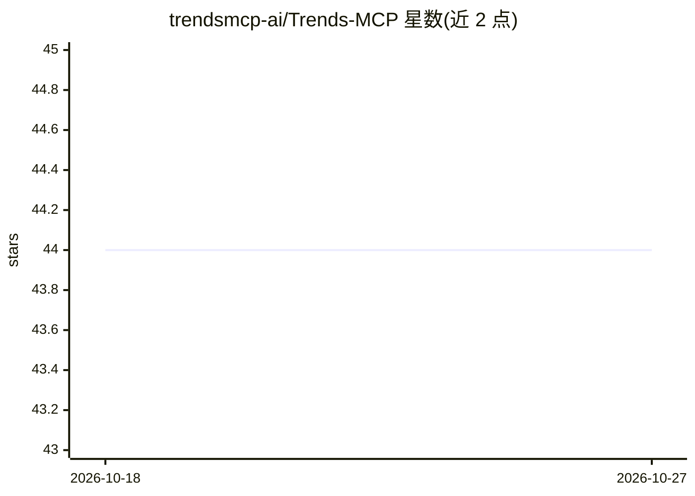

# trendsmcp-ai/Trends-MCP

⭐ 44 · Python · MIT · 推送 2026-08-29 · [GitHub](https://github.com/trendsmcp-ai/Trends-MCP) · [官网](https://trendsmcp.ai/) · 组织维护

**为 AI agent 提供实时趋势数据的 MCP server（30+ 来源）**

托管在 trendsmcp.ai 的 MCP 服务，向 AI agent 暴露三个工具：get_time_series（关键词历史序列）、get_growth（7天-5年多窗口百分比变化）、get_top_trends（各平台实时榜单）。数据来源覆盖 Google/YouTube/TikTok/Reddit/Amazon/Wikipedia/新闻情绪/npm/Steam 等 30 余个，索引归一化到 0–100。默认为托管 HTTP 接入，仓库另含 stdio 适配器可本地 pip 安装运行；需账号 API key（免费档每月 100 次请求），同一 key 可用于 REST API 与 Python 客户端。

## 筛选速览

| 维度 | 判定 | 备注 |
|---|---|---|
| AI 角色 | `ai-ecosystem` | LLM/agent 周边工具 |
| 许可风险 | `permissive` | MIT |
| 部署形态 | `library` | 以包/库形式分发 |
| 模型依赖 | locked-api |  |
| 硬件要求 | — | 无带数字的原话,不猜 |
| 安装摩擦 | `low` | 无编译、无系统依赖或容器化 |
| 成熟度 | — | 结构信号不足 |

## 能力要点

- 三个工具覆盖时序、增长率与实时榜单查询
- 30+ 数据源，单一 API key、无需各平台单独密钥
- 支持 Claude/Cursor/VS Code/ChatGPT/Windsurf/Cline 等 MCP 客户端接入
- 仓库提供 stdio 适配器与 REST API、Python 客户端

## 适用场景

- 让 AI agent 跨平台对比某个关键词的趋势增长
- 在 Cursor/Claude 等 MCP 客户端中查询实时热搜榜单
- 通过 REST 或 Python 客户端在自有脚本中获取趋势数据

## 场景标签

 · 领域:数据服务/AI agent 工具

## 证据(README 行号)

> L5: Live trend data for AI agents. Google, TikTok, YouTube, Amazon, Reddit, and 30+ other sources. One MCP connection, o
> L48: Hosted MCP at `https://api.trendsmcp.ai/mcp`. Same Bearer key for `POST https://api.trendsmcp.ai/api`. This repo al

## 星数曲线

2026-10-18 44 → 2026-10-27 44（+0）

---
*卡片 v1 · prompt 1.4 · 生成 2026-10-25 · 置信度 high · 依据 README sha `4903315f6faa` · [字段定义](../../DATASET.md)*
