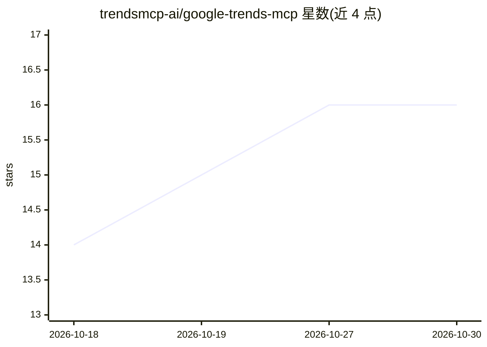

# trendsmcp-ai/google-trends-mcp

⭐ 16 · Python · MIT · 推送 2026-08-30 · [GitHub](https://github.com/trendsmcp-ai/google-trends-mcp) · [官网](https://trendsmcp.ai/google-trends) · 组织维护

**为 AI agent 提供多平台实时趋势数据的托管 MCP 服务器**

Trends MCP 是一个托管在 trendsmcp.ai 的 MCP 服务器，向 Claude、Cursor、VS Code、ChatGPT 等 MCP 客户端的 AI agent 提供实时趋势数据：Google、TikTok、YouTube、Amazon、Reddit 等 30+ 来源。提供三个工具：get_time_series（单关键词历史）、get_growth（7天–5年增长率）、get_top_trends（平台实时榜单）。需 API key，免费层每月 100 次请求，仓库内另含 stdio 适配器（pip install -e .）供 Glama 与本地宿主使用。限制：不支持地域细分、逐小时数据、单次跨源历史查询。

## 筛选速览

| 维度 | 判定 | 备注 |
|---|---|---|
| AI 角色 | `ai-ecosystem` | LLM/agent 周边工具 |
| 许可风险 | `permissive` | MIT |
| 部署形态 | `library` | 以包/库形式分发 |
| 模型依赖 | locked-api |  |
| 硬件要求 | — | 无带数字的原话,不猜 |
| 安装摩擦 | `low` | 无编译、无系统依赖或容器化 |
| 成熟度 | — | 结构信号不足 |

## 能力要点

- 三个工具：时间序列、多窗口增长率、实时榜单
- 覆盖 Google/TikTok/YouTube/Amazon/Reddit 等 30+ 来源，单一 API key
- 支持 Claude/Cursor/VS Code/ChatGPT/Windsurf/Cline 等客户端接入方式
- 同 key 可用 MCP 与 REST API，另有 Python 客户端 pip install trendsmcp

## 适用场景

- 让 Claude/Cursor 中的 agent 查询关键词在各平台的热度趋势
- 对比产品关键词在 Google、TikTok、Amazon 的增长
- 获取 Google Trends、Reddit、GitHub 等平台的实时热门榜单

## 场景标签

`数据分析` · 领域:效率与自动化

## 证据(README 行号)

> L5: Live trend data for AI agents. Google, TikTok, YouTube, Amazon, Reddit, and 30+ other sources. One MCP connection, o
> L48: Hosted MCP at `https://api.trendsmcp.ai/mcp`. Same Bearer key for `POST https://api.trendsmcp.ai/api`. This repo al

## 星数曲线

2026-10-18 14 → 2026-10-30 16（+2）

---
*卡片 v1 · prompt 1.4 · 生成 2026-10-30 · 置信度 high · 依据 README sha `65dbd6d06c9f` · [字段定义](../../DATASET.md)*
