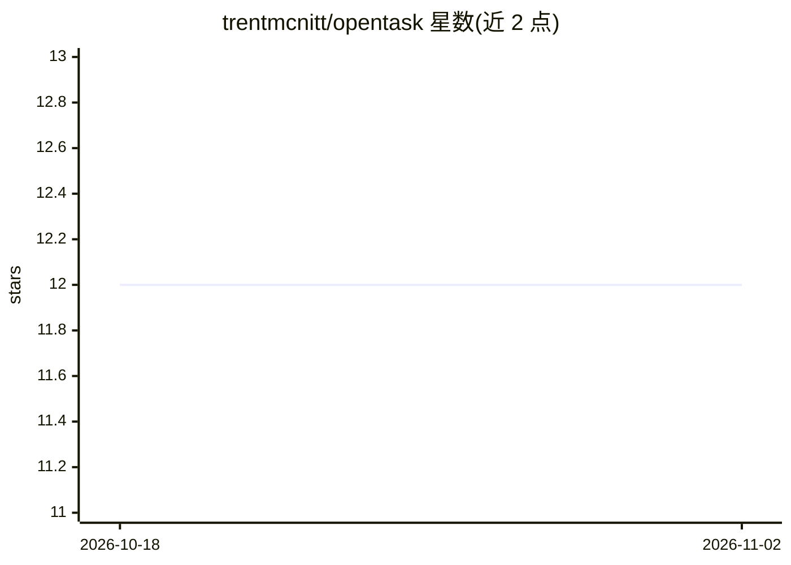

# trentmcnitt/opentask

⭐ 12 · TypeScript · NOASSERTION · 推送 2026-10-31 · [GitHub](https://github.com/trentmcnitt/opentask) · [官网](https://opentask.mcnitt.io) · 个人维护

**自托管的 AI 任务与习惯管理器（Web/iOS/Watch/Mac）**

作者为个人使用开发的自托管任务与习惯管理应用：以单个 Docker 容器加 SQLite 运行，提供 Web PWA、原生 iPhone（含小组件）、Apple Watch 与 Mac 应用，功能覆盖目标/截止日、批量推迟、周期重复、提醒与配额、撤销/重做、回收站、完整 REST API（OpenAPI 3.1）与 Webhook。AI 部分默认关闭：自然语言录入任务/提醒/配额并由 AI 抽取结构化字段、处理 Inbox 时建议项目并识别重复，支持 Claude、GPT-4.1-mini、Grok、DeepSeek、Ollama 等模型，附 250+ 场景评测集。手动安装需 Node.js 20+。

## 筛选速览

| 维度 | 判定 | 备注 |
|---|---|---|
| AI 角色 | `ai-enhanced` | 去掉 AI 部分产品仍成立 |
| 许可风险 | `viral` | NOASSERTION |
| 部署形态 | `self-host` | docker 或自建部署 |
| 模型依赖 | local-ok | 支持本地模型 |
| 硬件要求 | — | 无带数字的原话,不猜 |
| 安装摩擦 | `low` | 无编译、无系统依赖或容器化 |
| 成熟度 | `idea` | |

## 能力要点

- 自然语言输入任务/提醒/配额，AI 抽取标题、时间、周期、优先级等字段
- AI 功能默认关闭，关闭后 UI 无 AI 痕迹；各功能可分别配置模型
- 单容器 + SQLite（WAL），支持 Authelia/Authentik 反代认证
- 完整 REST API、Webhook（HMAC-SHA256）与 JSON/CSV 导出

## 适用场景

- 在自己服务器上管理任务、提醒与习惯配额，不依赖第三方云服务
- 用一句话录入任务，让 AI 填充截止时间、周期等细节
- 通过 REST API 与 Webhook 把任务系统接入 n8n、Home Assistant 等自动化流程

## 场景标签

 · 领域:个人生产力/自托管应用

## 证据(README 行号)

> L56: ## 🧠 AI-native task management (optional)
> L66: - **Entirely optional** — Disabled by default. Turn it off and every trace of AI disappears from the UI. Works with

## 星数曲线

2026-10-18 12 → 2026-11-02 12（+0）

---
*卡片 v1 · prompt 1.4 · 生成 2026-10-31 · 置信度 high · 依据 README sha `378ef2347afa` · [字段定义](../../DATASET.md)*
