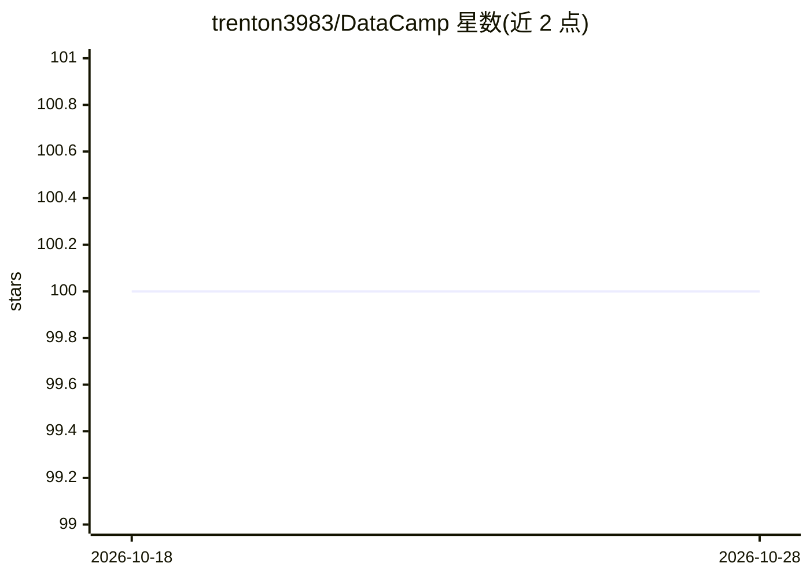

# trenton3983/DataCamp

⭐ 100 · Jupyter Notebook · 推送 2025-12-17 · [GitHub](https://github.com/trenton3983/DataCamp) · [官网](https://github.com/trenton3983/DataCamp) · 个人维护

**DataCamp 数据科学课程的个人学习笔记与代码仓库**

个人学习者将 DataCamp 平台上的数据科学、机器学习与统计课程整理为可完整执行的 Jupyter Notebook 与笔记，并附课程项目解答。Notebook 数据下载链接内嵌于文档，无隐藏函数，部分需要后端准备（如下载数据文件或搭建 PostgreSQL 数据库）；另提供已执行的 HTML 版本在线浏览。仓库不提供安装流程或打包产物，内容以课程章节组织，供其他学习者查阅与对照练习。

## 筛选速览

| 维度 | 判定 | 备注 |
|---|---|---|
| AI 角色 | `ai-knowledge` | 知识聚合/清单类 |
| 许可风险 | `none` | — |
| 部署形态 | `None` |  |
| 模型依赖 | — | README 未给出锁定关系 |
| 硬件要求 | — | 无带数字的原话,不猜 |
| 安装摩擦 | `low` | 无编译、无系统依赖或容器化 |
| 成熟度 | — | 结构信号不足 |

## 能力要点

- DataCamp 课程转化为可完整执行的 Jupyter Notebook
- 涵盖数据科学、机器学习与统计课程及项目解答
- 提供已执行 Notebook 的在线 HTML 版本

## 适用场景

- 想离线复习 DataCamp 课程内容的学习者查阅代码笔记
- 寻找数据科学课程配套的项目解答参考
- 对照不同平台课程格式做自学规划

## 场景标签

`教程课程` · 领域:学习与行业

## 证据(README 行号)

> L5: - As noted, the courses are interactive, in the browser, so I have taken the time to create Jupyter Notebooks for mo
> L9: - An executed HTML version of my notebooks can be found [here][1].

## 星数曲线

2026-10-18 100 → 2026-10-28 100（+0）

---
*卡片 v1 · prompt 1.4 · 生成 2026-10-23 · 置信度 high · 依据 README sha `64babfc6180e` · [字段定义](../../DATASET.md)*
