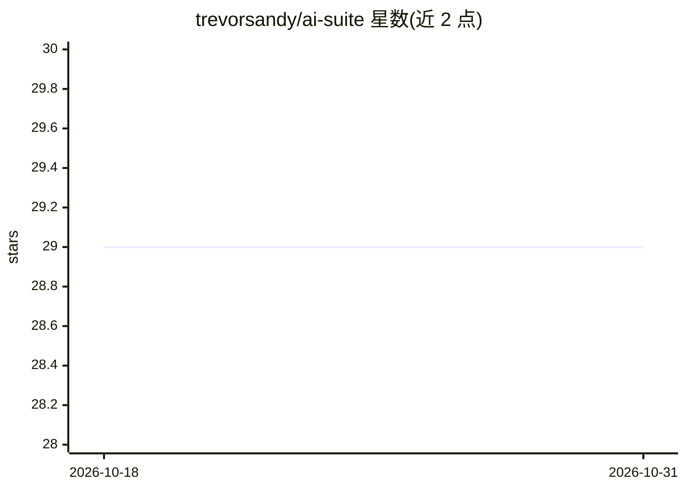

# trevorsandy/ai-suite

⭐ 29 · Python · Apache-2.0 · 推送 2026-07-19 · [GitHub](https://github.com/trevorsandy/ai-suite) · 个人维护

**自托管本地 AI 全家桶：Docker Compose 一键编排 n8n、Ollama 等 19 个服务**

面向开发者与自托管用户的开源 Docker Compose 编排套件，通过 Python 脚本 suite_services.py 一键安装和启动 n8n 自动化、OpenClaw 个人助理、Open WebUI、Ollama/LLaMA.cpp 本地模型运行时、Flowise、Langfuse、MCP Gateway、Qdrant、Neo4j 等约 19 个服务，支持按 profile 选配功能模块与 CPU/GPU（Nvidia/AMD）配置。扩展自 Cole Medin 的 Self-hosted AI Package。要求 32GB 内存（最低 8GB）、40GB 磁盘、Docker 20.10+、Python 3.10+、Node 22.16+；Apple Silicon 上 GPU 无法透传给 Docker，需 CPU 运行或将 LLAMA 放在宿主机。

## 筛选速览

| 维度 | 判定 | 备注 |
|---|---|---|
| AI 角色 | `ai-ecosystem` | LLM/agent 周边工具 |
| 许可风险 | `permissive` | Apache-2.0 |
| 部署形态 | `self-host` | docker 或自建部署 |
| 模型依赖 | local-ok | 支持本地模型 |
| 硬件要求 | — | 无带数字的原话,不猜 |
| 安装摩擦 | `low` | 无编译、无系统依赖或容器化 |
| 成熟度 | — | 结构信号不足 |

## 能力要点

- 单一 suite_services.py 脚本完成安装、启动、停止与更新等操作
- Ollama 与 LLaMA.cpp 双 LLM 运行时可选，支持 Nvidia/AMD GPU 与宿主机部署
- 通过 --profile 参数按需选配 n8n、Flowise、Langfuse、Supabase 等功能模块
- 包含 Caddy/Authelia 提供 HTTPS 与认证授权管理

## 适用场景

- 在本地或私有服务器一键搭建完整的 AI 工作流与 agent 环境
- 自托管 n8n 自动化平台并搭配本地 LLM 运行
- 搭建带观测（Langfuse）与向量库（Qdrant）的私有 AI 基础设施

## 场景标签

 · 领域:AI 基础设施/自托管部署

## 证据(README 行号)

> L7: It provides an open, curated, pre-configured **Docker Compose** configuration
> L8: file along with **Python and Bash shell scripts** that bootstraps fully featured
> L9: Local AI Agents, personal AI Assistant and a Low/No Code environment on a self-hosted
> L36: ✅ **Ollama** - Cross-platform LLM platform to install

## 星数曲线

2026-10-18 29 → 2026-10-31 29（+0）

---
*卡片 v1 · prompt 1.4 · 生成 2026-10-26 · 置信度 mid · 依据 README sha `e4071280bc33` · [字段定义](../../DATASET.md)*
