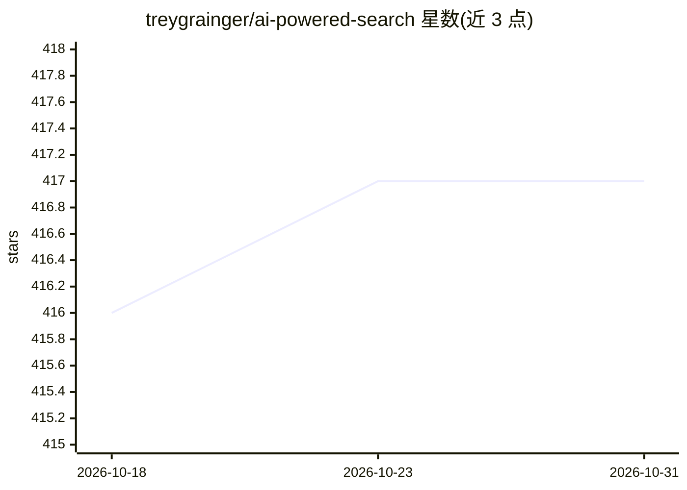

# treygrainger/ai-powered-search

⭐ 417 · Jupyter Notebook · 推送 2026-09-21 · [GitHub](https://github.com/treygrainger/ai-powered-search) · [官网](https://aipoweredsearch.com) · 个人维护

**《AI-Powered Search》图书配套的可运行代码示例集**

Manning 出版书籍《AI-Powered Search》(Trey Grainger、Doug Turnbull、Max Irwin 著) 的代码库，覆盖语义搜索、RAG、问答摘要、LLM 微调、个性化搜索、用户信号收集、学习排序、点击模型、生成式与混合搜索等主题的 Jupyter Notebook 示例。全部代码以 Docker 容器打包，git clone 后 docker compose up 即可在 localhost:8888 运行。代码为 Python，重用 PySpark 做数据处理，默认搜索引擎为 Apache Solr，示例做了引擎抽象，可替换为其他搜索引擎与向量数据库。代码以 Apache 2.0 许可开源。

## 筛选速览

| 维度 | 判定 | 备注 |
|---|---|---|
| AI 角色 | `ai-knowledge` | 知识聚合/清单类 |
| 许可风险 | `none` | — |
| 部署形态 | `self-host` | docker 或自建部署 |
| 模型依赖 | — | README 未给出锁定关系 |
| 硬件要求 | — | 无带数字的原话,不猜 |
| 安装摩擦 | `low` | 无编译、无系统依赖或容器化 |
| 成熟度 | — | 结构信号不足 |

## 能力要点

- 全部示例以 Jupyter Notebook 提供并打包为 Docker 容器
- 覆盖语义搜索、RAG、学习排序、点击模型、生成式搜索等主题
- 默认搜索引擎为 Apache Solr，示例做了引擎抽象可替换
- 数据处理使用 Python 与 PySpark

## 适用场景

- 随书动手运行书中搜索技术示例
- 学习语义搜索、RAG 与学习排序的实现方法
- 在可替换的搜索引擎抽象上试验自己的数据

## 场景标签

`RAG` `语义搜索` `教程课程` · 领域:知识与检索

## 证据(README 行号)

> L3: Code examples for the book _AI-Powered Search_ by Trey Grainger, Doug Turnbull, and Max Irwin. Published by Manning 
> L10: _AI-Powered Search_ teaches you the latest machine learning techniques to build search engines that continuously le

## 星数曲线

2026-10-18 416 → 2026-10-31 417（+1）

---
*卡片 v1 · prompt 1.4 · 生成 2026-10-21 · 置信度 high · 依据 README sha `d4483d2d773b` · [字段定义](../../DATASET.md)*
