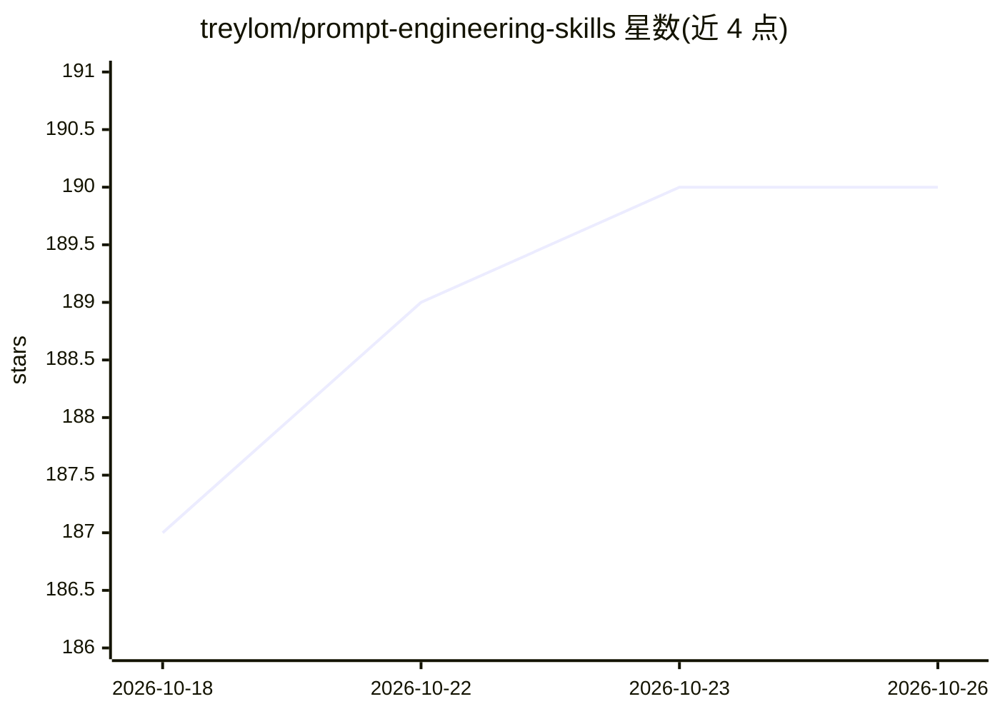

# treylom/prompt-engineering-skills

⭐ 190 · JavaScript · NOASSERTION · 推送 2026-09-26 · [GitHub](https://github.com/treylom/prompt-engineering-skills) · 个人维护

**跨平台（Claude Code/GPTs/Gems）通用提示工程技能合集**

面向 Claude Code、ChatGPT GPTs 与 Gemini Gems 使用者的提示工程技能仓库：以单一权원統合本为核心，附领域分册（GPT-6/Claude Opus 5.5/Gemini 3.1 模型策略、图像与视频、研究与事实核查、幻灯片、专家领域 Priming、Context Engineering）及 Skills 2.0 分割模块。技能遵循 Agent Skills 开放标准，提供 git clone 安装命令、PowerShell 版本、GPTs/Gems 的 Knowledge 上传导出脚本与按场景选择指南。

## 筛选速览

| 维度 | 判定 | 备注 |
|---|---|---|
| AI 角色 | `ai-knowledge` | 知识聚合/清单类 |
| 许可风险 | `none` | NOASSERTION |
| 部署形态 | `None` |  |
| 模型依赖 | — | README 未给出锁定关系 |
| 硬件要求 | — | 无带数字的原话,不猜 |
| 安装摩擦 | `low` | 无编译、无系统依赖或容器化 |
| 成熟度 | — | 结构信号不足 |

## 能力要点

- 单一权원統合本 + 领域分册 + Skills 2.0 分割模块的组织结构
- 覆盖 GPT-6 Sol / Claude Opus 5.5 / Gemini 3.1 等模型特定提示策略
- export-knowledge.sh 生成 GPTs/Gems 上传用 Knowledge 捆绑文件
- Claude Code / Codex CLI 双平台插件安装命令

## 适用场景

- 为 Claude Code 安装提示工程技能与命令
- 为自建 GPT 或 Gem 上传提示工程知识库
- 按场景查找图像、研究、幻灯片等领域的提示策略

## 场景标签

`提示工程` · 领域:Agent 开发

## 证据(README 行号)

> L3: Claude Code, ChatGPT GPTs, Gemini Gems에서 함께 쓰는 프롬프트 엔지니어링 스킬 저장소입니다. 모델별 전략, 이미지/동영상, 리서치/팩트체크, 슬라이드, 전문가 도메인 프라이밍, 
> L27: |영역|통합본 위치|분할본 파일|
> L109: This repository ships both a canonical merged skill (`skills/prompt-engineering-guide/references/full.md`) and per

## 星数曲线

2026-10-18 187 → 2026-10-26 190（+3）

---
*卡片 v1 · prompt 1.4 · 生成 2026-10-22 · 置信度 high · 依据 README sha `041cac34011c` · [字段定义](../../DATASET.md)*
