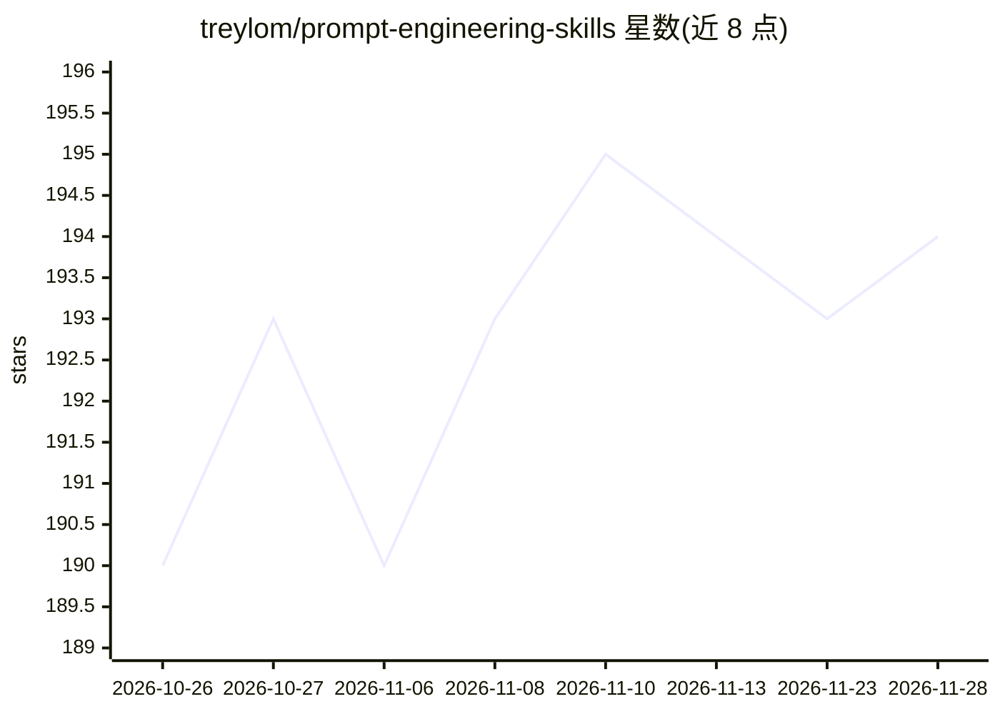

# treylom/prompt-engineering-skills

⭐ 194 · JavaScript · NOASSERTION · 推送 2026-11-18 · [GitHub](https://github.com/treylom/prompt-engineering-skills) · 个人维护

**面向 Claude Code/ChatGPT/Gemini 用户的提示词工程技能资料集**

供 Claude Code、ChatGPT GPTs、Gemini Gems 使用的提示词工程技能仓库，覆盖模型特定策略（GPT、Claude、Gemini/Veo）、图像与视频提示词、研究与事实核查、幻灯片、专家领域前置以及 Context Engineering 原则。组织形式为单一整合文档加分区指南，遵循 Agent Skills 开放标准，提供 Claude Code 插件安装、git clone 脚本安装及 GPTs/Gems 的知识文件导出脚本。GPTs 受 Knowledge 文件 10 个上限约束，需选择上传。

## 筛选速览

| 维度 | 判定 | 备注 |
|---|---|---|
| AI 角色 | `ai-knowledge` | 知识聚合/清单类 |
| 许可风险 | `none` | NOASSERTION |
| 部署形态 | `None` |  |
| 模型依赖 | locked-api |  |
| 硬件要求 | — | 无带数字的原话,不猜 |
| 安装摩擦 | `low` | 无编译、无系统依赖或容器化 |
| 成熟度 | — | 结构信号不足 |

## 能力要点

- 整合本 + 分区指南 + Skills 2.0 分割模块三种资产形态，按环境选择安装
- 遵循 Agent Skills 开放标准，同一仓库供 Claude Code 与 Codex CLI 使用
- 提供 export-knowledge.sh 脚本生成符合文件名引用契约的上传包
- 覆盖 GPT/Claude/Gemini/Veo/图像等多模型分区提示词策略

## 适用场景

- 为 Claude Code 安装提示词工程参考技能
- 向 GPTs/Gems 上传知识文件搭建提示词生成器
- 按模型版本查找对应的提示词策略指南

## 场景标签

`提示工程` `编码 Agent` `教程课程` · 领域:Agent 开发

## 证据(README 行号)

> L3: Claude Code, ChatGPT GPTs, Gemini Gems에서 함께 쓰는 프롬프트 엔지니어링 스킬 저장소입니다. 모델별 전략, 이미지/동영상, 리서치/팩트체크, 슬라이드, 전문가 도메인 프라이밍, 
> L5: > **운영 구조**: 단일 권원 통합본(`skills/prompt-engineering-guide/references/full.md`) + 영역별 분할 가이드(`skills/*.md`) + Skills 2.

## 星数曲线

2026-10-26 190 → 2026-11-28 194（+4）

---
*卡片 v1 · prompt 1.4 · 生成 2026-11-25 · 置信度 high · 依据 README sha `f86973f2eb3e` · [字段定义](../../DATASET.md)*
