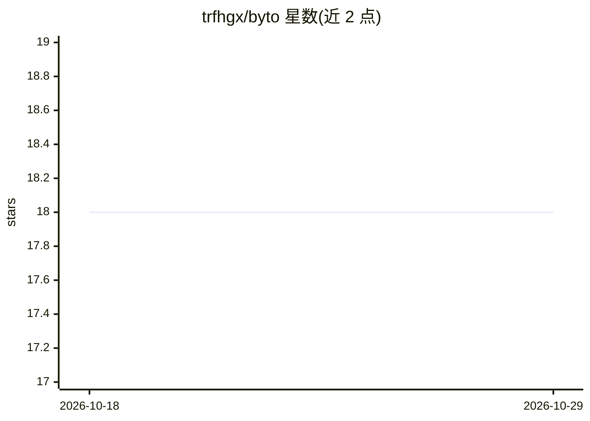

# trfhgx/byto

⭐ 18 · Go · MIT · 推送 2026-08-08 · [GitHub](https://github.com/trfhgx/byto) · 个人维护

**OpenAI 兼容的 Vertex AI Gemini Go 网关**

用 Go 编写的 API 网关，将 OpenAI 兼容的聊天应用接入 Google Gemini 模型（经 Vertex AI），使现有 OpenAI 风格工具无需改造即可调用 Gemini。机制上提供显式模型路由（无默认模型，缺失返回 400）、启动时模型目录刷新并用 countTokens 校验可用性、自适应每模型并发与指数退避、API-key 网关鉴权、异步 chat jobs 与缓存端点、JSONL 结构化日志。可在本地、Docker 或 Cloud Run 运行，发布含 macOS/Linux/Windows 的 AMD64/ARM64 二进制。使用者包括角色扮演聊天机器人等聊天应用的开发者。

## 筛选速览

| 维度 | 判定 | 备注 |
|---|---|---|
| AI 角色 | `ai-ecosystem` | LLM/agent 周边工具 |
| 许可风险 | `permissive` | MIT |
| 部署形态 | `self-host` | docker 或自建部署 |
| 模型依赖 | — | README 未给出锁定关系 |
| 硬件要求 | — | 无带数字的原话,不猜 |
| 安装摩擦 | `low` | 无编译、无系统依赖或容器化 |
| 成熟度 | — | 结构信号不足 |

## 能力要点

- OpenAI 兼容 /v1/chat/completions 接口转发至 Vertex AI Gemini
- 启动时模型目录刷新并用 countTokens 逐模型校验可用性
- 自适应每模型并发、有界等待队列与指数退避
- 异步 chat jobs、/v1/caches 缓存端点与 JSONL 结构化日志

## 适用场景

- 让现有 OpenAI 兼容聊天工具直接使用 Vertex AI Gemini
- 在 Vertex AI 免费额度上测试和运行 AI 应用
- 统一管理 Gemini 的鉴权、模型列表与流式/缓存/推理控制

## 场景标签

`模型网关` · 领域:Agent 开发

## 证据(README 行号)

> L12: Byto connects OpenAI-compatible chat apps to Google's Gemini models through Vertex AI.
> L15: your apps -> Byto -> Vertex AI Gemini
> L146: - `POST /v1/chat/completions`

## 星数曲线

2026-10-18 18 → 2026-10-29 18（+0）

---
*卡片 v1 · prompt 1.4 · 生成 2026-10-29 · 置信度 high · 依据 README sha `a6ddea74e2c3` · [字段定义](../../DATASET.md)*
