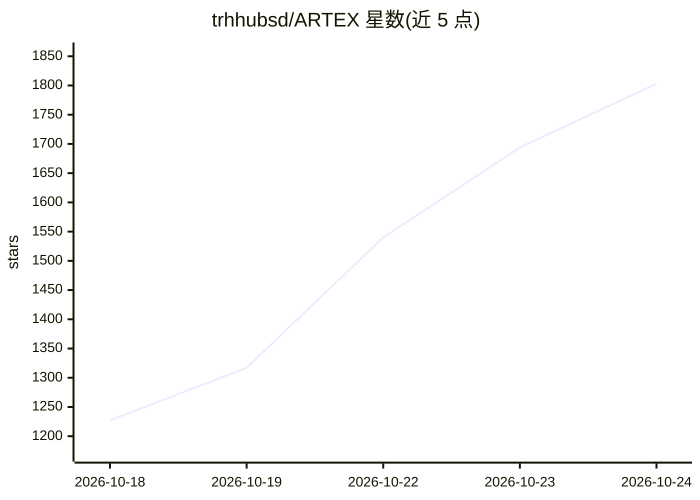

# trhhubsd/ARTEX

⭐ 1,864 · Go · AGPL-3.0 · 推送 2026-10-19 · [GitHub](https://github.com/trhhubsd/ARTEX) · [官网](https://artex-demo.vercel.app/) · 组织维护 · 中文 README

**面向隔离靶场的多 agent LLM 自主渗透测试系统**

Go 后端（内嵌 Next.js 前端）+ PostgreSQL 的多 agent 自主渗透测试系统，运行于隔离实验环境：planner 与 worker 共享资产图与探索图，事件驱动地派发意图、执行工具并写回事实与漏洞，支持人在环路审批、全流量录制、跨 worker 过程检索与共享 todolist 多步攻击链。可从 ScopeSentry 同步资产，内置漏洞复测 Agent，支持远程 MCP 接入。以单二进制或 Docker Compose 交付，LLM 需配置 Anthropic 或 OpenAI API Key。作者声明仅供本地学习与隔离环境验证，禁止对线上系统使用。

## 筛选速览

| 维度 | 判定 | 备注 |
|---|---|---|
| AI 角色 | `ai-native` | 本体是模型或模型工具 |
| 许可风险 | `viral` | AGPL-3.0 |
| 部署形态 | `self-host` | docker 或自建部署 |
| 模型依赖 | — | README 未给出锁定关系 |
| 硬件要求 | — | 无带数字的原话,不猜 |
| 安装摩擦 | `low` | 无编译、无系统依赖或容器化 |
| 成熟度 | — | 结构信号不足 |

## 能力要点

- 资产图 + 探索图双图架构，锚点关联支持覆盖度可视
- planner/worker 多 agent 事件驱动闭环，共享 todolist 稳定多步攻击链
- worker 间跨执行过程检索（search_all_worker_traces）
- 人在环路审批、全流量 MITM 记录、ScopeSentry 资产同步、漏洞复测 Agent

## 适用场景

- 在本地隔离靶场自动化执行多步渗透测试探索
- 以可视化界面跟踪 agent 探索链路与资产覆盖度
- 对已发现漏洞发起自动复测并更新处置状态

## 场景标签

`多智能体` `网络安全` · 领域:Agent 开发

## 证据(README 行号)

> L3: AI autonomous penetration testing system. Multi-agent LLM, Go backend, Next.js frontend.
> L10: ARTEX is a multi-agent system for autonomous penetration testing in an isolated lab: a planner and workers share an
> L233: ARTEX 是一套 **LLM 多 agent 驱动的自主渗透系统**：Go 单体后端（内嵌 Next.js 前端）+ PostgreSQL，agent 能力由 `norma` SDK 提供（`agentcore` / `too

## 星数曲线

2026-10-18 1,227 → 2026-10-24 1,803（+576）

---
*卡片 v1 · prompt 1.4 · 生成 2026-10-21 · 置信度 high · 依据 README sha `342d0e8ed571` · [字段定义](../../DATASET.md)*
