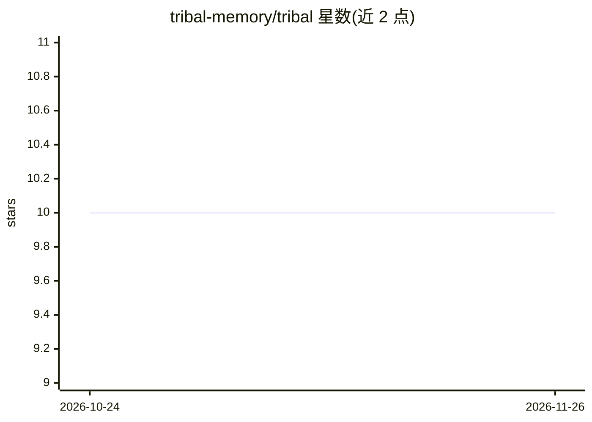

# tribal-memory/tribal

⭐ 10 · Rust · 推送 2026-08-06 · [GitHub](https://github.com/tribal-memory/tribal) · [官网](https://tribal.build) · 个人维护

**为工程团队提供基于 MCP 的语义记忆知识服务**

Tribal 是自托管的个人知识上下文引擎：从开发工作中捕获经验教训、调试洞察、启发式方法与决策理由，经嵌入后存入 Postgres + pgvector，通过 MCP（stdio 传输）作为服务器供编码 agent 检索。以 Rust 实现，要求 Rust 1.89+ 与 nightly rustfmt、Docker、just、sqlx-cli、cargo-deny 等工具链；通过 git clone 源码配合 just 命令完成数据库启动、迁移与服务运行。

## 筛选速览

| 维度 | 判定 | 备注 |
|---|---|---|
| AI 角色 | `ai-ecosystem` | LLM/agent 周边工具 |
| 许可风险 | `none` | — |
| 部署形态 | `library` | 以包/库形式分发 |
| 模型依赖 | — | README 未给出锁定关系 |
| 硬件要求 | — | 无带数字的原话,不猜 |
| 安装摩擦 | `low` | 无编译、无系统依赖或容器化 |
| 成熟度 | — | 结构信号不足 |

## 能力要点

- 基于 MCP 协议（stdio 传输）向编码 agent 提供知识检索
- Postgres + pgvector 存储嵌入向量，支持按项目运行
- Rust 实现，自托管部署
- 通过 just 命令封装数据库启动、迁移、测试与运行流程

## 适用场景

- 沉淀团队开发过程中的调试经验与决策依据供 agent 检索
- 为 Claude Code 等编码 agent 接入团队隐性知识
- 自托管管理工程知识库并按项目区分上下文

## 场景标签

`Agent 记忆` · 领域:Agent 开发

## 证据(README 行号)

> L3: A personal knowledge context engine for software development. Tribal captures
> L5: development work, then makes that knowledge retrievable by coding agents via
> L6: MCP (Model Context Protocol).

## 星数曲线

2026-10-24 10 → 2026-11-26 10（+0）

---
*卡片 v1 · prompt 1.4 · 生成 2026-11-19 · 置信度 high · 依据 README sha `3d8e475b41c2` · [字段定义](../../DATASET.md)*
