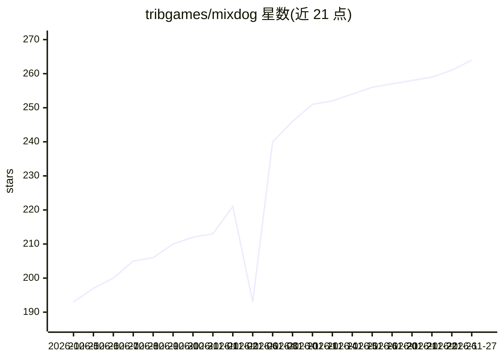

# tribgames/mixdog

⭐ 264 · Rust · Apache-2.0 · 推送 2026-11-26 · [GitHub](https://github.com/tribgames/mixdog) · [官网](https://mixdog.ai/) · 个人维护

**开源桌面编码 Agent，主模型规划、低成本模型执行搜索/编辑/审查**

基于 Electron 的桌面编码 Agent：支持按角色混合模型（主模型规划，较廉价模型并行执行搜索、编辑、审查），内置自动推理努力分配（本地 150 MB CPU 模型判定）、Bot 与群房间、编辑器/终端/Git 工作区、浏览器与桌面控制等功能。提供 Windows/macOS/Linux 安装包与无头模式 `mixdogd exec`。需登录 ChatGPT/Claude/Grok 等账号或填入 API key 才能使用云端模型；本地模型下载仅限 Windows x64 + NVIDIA GPU。

## 筛选速览

| 维度 | 判定 | 备注 |
|---|---|---|
| AI 角色 | `ai-native` | 本体是模型或模型工具 |
| 许可风险 | `permissive` | Apache-2.0 |
| 部署形态 | `desktop` | 安装包/桌面程序 |
| 模型依赖 | locked-api |  |
| 硬件要求 | — | 无带数字的原话,不猜 |
| 安装摩擦 | `low` | 无编译、无系统依赖或容器化 |
| 成熟度 | — | 结构信号不足 |

## 能力要点

- 按角色混合模型：主模型规划，廉价模型并行搜索/编辑/审查，可设回退模型
- 自动推理努力分配：本地 CPU 运行的 150 MB 模型约 0.1 秒判定
- Bot 与房间机制：自定义模型、工具、权限的多 Bot 协作
- Goals、定时任务与 Webhook 持续运行，可从手机端加密续接

## 适用场景

- 用已有 Claude/ChatGPT/Grok 订阅在桌面端运行编码 Agent
- 让多个模型分工协作完成代码搜索、编辑与审查
- 通过无头命令在终端中执行单次修复任务
- 配置定时目标让 Agent 持续处理任务并从手机跟进

## 场景标签

`编码 Agent` `多智能体` · 领域:Agent 开发

## 证据(README 行号)

> L9:  The open-source coding agent that uses 63% fewer tokens.
> L34: - 63% fewer tokens than Codex CLI on the same model, at the
> L41: - Mix models by role and scale from **Solo to Swarm** — a strong model leads

## 星数曲线

2026-10-25 193 → 2026-11-27 264（+71）

---
*卡片 v1 · prompt 1.4 · 生成 2026-11-25 · 置信度 high · 依据 README sha `d53ca5cb2383` · [字段定义](../../DATASET.md)*
