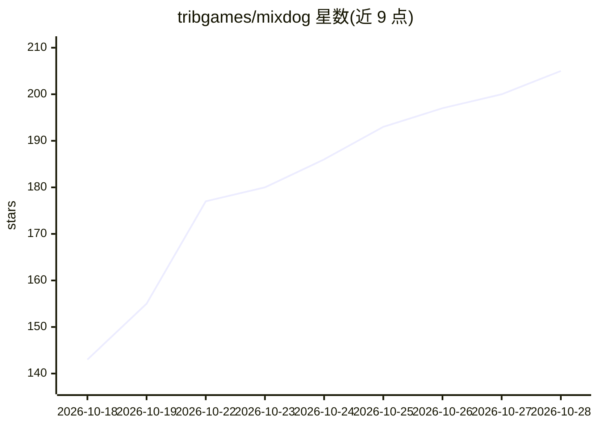

# tribgames/mixdog

⭐ 205 · JavaScript · Apache-2.0 · 推送 2026-10-27 · [GitHub](https://github.com/tribgames/mixdog) · 组织维护

**开源桌面编码 agent：主模型规划、廉价模型并行执行搜索与审校**

基于 Electron 的桌面编码代理：强模型担任 lead，廉价模型并行执行搜索、编辑与代码审校，并内置自动推理力度调节（本地 CPU 上约 150MB 模型在 0.1s 内判定每步所需 effort）。支持 Claude/ChatGPT/Grok/Muse Code 订阅 OAuth、各家 API key 或内置本地模型（Windows x64 + NVIDIA GPU），自带编辑器、终端、Git/GitHub、代码图与语言服务器。提供三平台安装包与 npm 全局安装两种方式；README 附 Terminal-Bench 对比数据。

## 筛选速览

| 维度 | 判定 | 备注 |
|---|---|---|
| AI 角色 | `ai-native` | 本体是模型或模型工具 |
| 许可风险 | `permissive` | Apache-2.0 |
| 部署形态 | `desktop` | 安装包/桌面程序 |
| 模型依赖 | locked-api |  |
| 硬件要求 | — | 无带数字的原话,不猜 |
| 安装摩擦 | `low` | 无编译、无系统依赖或容器化 |
| 成熟度 | — | 结构信号不足 |

## 能力要点

- lead 模型 + 多廉价模型按角色并行分工（Solo 到 Swarm）
- 自动推理力度判定，由本地 CPU 上约 150MB 模型执行，默认开启
- 内置 Local Provider 在应用内下载运行本地模型
- Goals/定时任务/webhook 自主运行，手机端加密续接

## 适用场景

- 让 AI agent 在桌面工作区内自主完成编码任务
- 用现有 Claude/ChatGPT/Grok 订阅驱动编码 agent
- 通过 mixdog exec 在终端做无头单模型自动化任务

## 场景标签

`编码 Agent` `多智能体` · 领域:Agent 开发

## 证据(README 行号)

> L36: - Mix models by role and scale from **Solo to Swarm** — a strong model leads
> L37:  while cheaper ones search, edit, and review in parallel.

## 星数曲线

2026-10-18 143 → 2026-10-28 205（+62）

---
*卡片 v1 · prompt 1.4 · 生成 2026-10-22 · 置信度 high · 依据 README sha `49ee0f597a23` · [字段定义](../../DATASET.md)*
