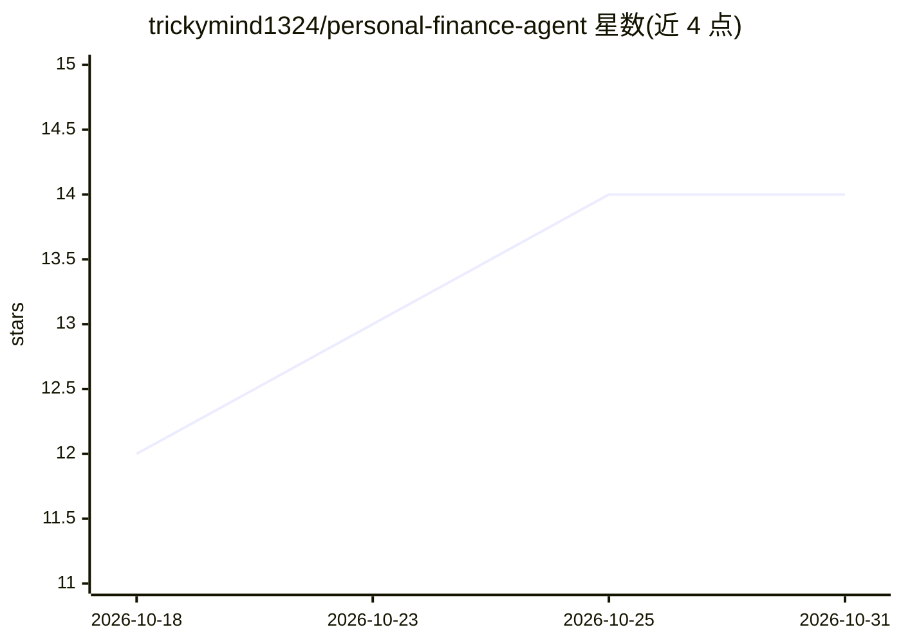

# trickymind1324/personal-finance-agent

⭐ 14 · Python · 推送 2026-09-15 · [GitHub](https://github.com/trickymind1324/personal-finance-agent) · 个人维护

**个人消费决策 agent：基于90天余额预测判定支出是否安全**

面向个人用户的支出可负担性 agent：对每笔消费请求输出全额支付、部分支付、分期、等待或不建议执行的决定，并给出今日最大安全支付额、带日期的付款计划、全额支付最早日期及需削减的弹性支出。核心机制：模型只负责证据边界（从收据图片与消息中抽取账本事实），下游决策为确定性、经单元测试的代码，以90天余额预测对用户最低余额线作为安全权威。默认离线路径经提交的缓存可零 API key、零调用地逐位复现输出；需 ANTHROPIC_API_KEY 才能重建缓存，费用按次/按运行/按 token 以美元封顶。含提示注入纵深防御（defanged 分隔、逐字记录命令式语句、代码侧独立扫描）与最多4轮的有界工具循环。冷启动重跑感知层不保证字节级一致，README 明确声明。

## 筛选速览

| 维度 | 判定 | 备注 |
|---|---|---|
| AI 角色 | `ai-native` | 本体是模型或模型工具 |
| 许可风险 | `none` | — |
| 部署形态 | `library` | 以包/库形式分发 |
| 模型依赖 | — | README 未给出锁定关系 |
| 硬件要求 | — | 无带数字的原话,不猜 |
| 安装摩擦 | `low` | 无编译、无系统依赖或容器化 |
| 成熟度 | — | 结构信号不足 |

## 能力要点

- 模型仅在证据边界抽取事实，全部输出列为账本的纯函数
- 默认离线路径经内容寻址缓存实现零 API 调用、逐位复现的 output.csv
- 消息与图片按不可信内容处理：defanged 分隔、逐字记录命令式语句、代码侧独立扫描
- 付费调用按次/按运行/token/美元四重封顶并有预检

## 适用场景

- 判断某笔大额消费今天能否安全支付、该付多少
- 获得带日期的付款计划与最早可全额支付的日期
- 识别需要停止或削减的弹性支出以腾出预算

## 场景标签

 · 领域:个人理财/AI agent

## 证据(README 行号)

> L1: # Personal Finance Agent
> L9: - **The model never decides money.** Every output column is a pure function of a truthful ledger — the hard part is 

## 星数曲线

2026-10-18 12 → 2026-10-31 14（+2）

---
*卡片 v1 · prompt 1.4 · 生成 2026-10-31 · 置信度 mid · 依据 README sha `d02bd8823dda` · [字段定义](../../DATASET.md)*
