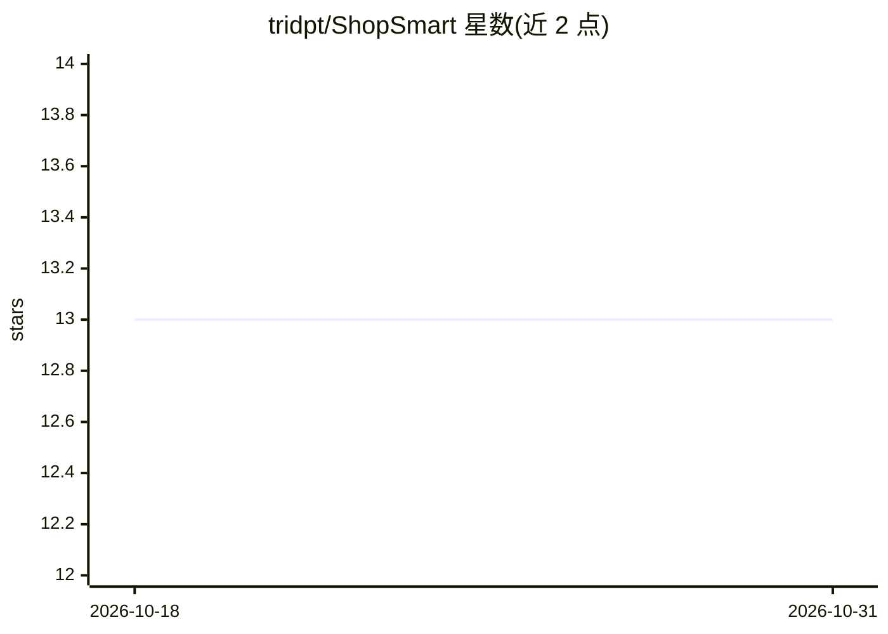

# tridpt/ShopSmart

⭐ 13 · Python · MIT · 推送 2026-07-23 · [GitHub](https://github.com/tridpt/ShopSmart) · 个人维护

**面向越南电商的 AI 购物助手：对话搜索、比价与降价追踪**

基于 Flask + SQLite 的多用户 Web 应用：通过自然语言对话调用 Google Gemini 2.5 Flash 驱动的 agent（6 个工具：网页搜索、价格抓取、加入追踪、价格分析、通知等），在全网搜索商品、抓取商品页价格并做趋势分析与购买建议。后台定时任务周期性重抓追踪商品并记录历史，支持站内通知及可选 Telegram/邮件推送；JWT 认证隔离各用户数据。需自行配置 Gemini API key，克隆源码后 pip 安装依赖并运行 Flask 服务。

## 筛选速览

| 维度 | 判定 | 备注 |
|---|---|---|
| AI 角色 | `ai-native` | 本体是模型或模型工具 |
| 许可风险 | `permissive` | MIT |
| 部署形态 | `library` | 以包/库形式分发 |
| 模型依赖 | — | README 未给出锁定关系 |
| 硬件要求 | — | 无带数字的原话,不猜 |
| 安装摩擦 | `low` | 无编译、无系统依赖或容器化 |
| 成熟度 | — | 结构信号不足 |

## 能力要点

- Gemini 2.5 Flash 驱动的 agent 对话式搜索与比价（6 个 agent 工具）
- 后台定时重抓追踪商品并记录价格历史
- 价格趋势 AI 分析与购买建议
- 站内通知 + 可选 Telegram/邮件降价推送，JWT 多用户隔离

## 适用场景

- 我想用对话方式搜索并比较商品价格
- 我想追踪心仪商品并在降价时收到提醒
- 我想获得基于历史价格的趋势分析和购买建议

## 场景标签

`聊天机器人` · 领域:对话与助手

## 证据(README 行号)

> L3: AI-powered shopping assistant that helps you find the best deals, compare prices, and track product prices across th
> L29: |AI Brain|Google Gemini 2.5 Flash (`google-genai` SDK)|

## 星数曲线

2026-10-18 13 → 2026-10-31 13（+0）

---
*卡片 v1 · prompt 1.4 · 生成 2026-10-31 · 置信度 mid · 依据 README sha `df2d4c37faf1` · [字段定义](../../DATASET.md)*
