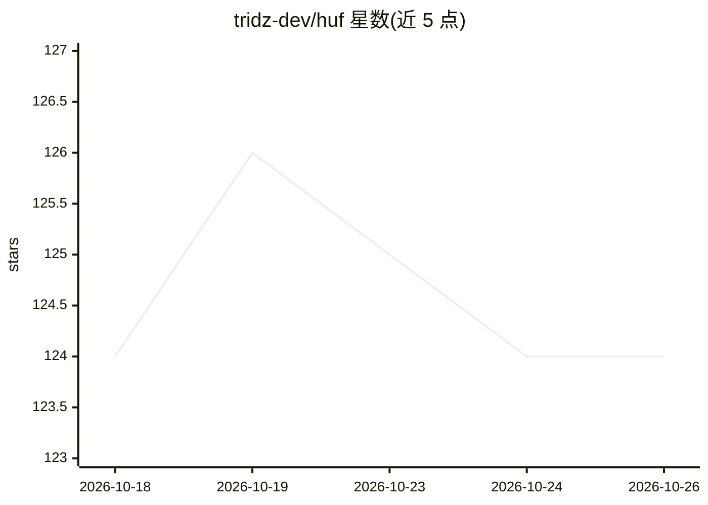

# tridz-dev/huf

⭐ 124 · Python · AGPL-3.0 · 推送 2026-10-24 · [GitHub](https://github.com/tridz-dev/huf) · [官网](https://huf.ai/) · 组织维护

**自托管多 agent AI 基础设施：为团队与产品提供编排、执行与网关**

基于 Frappe 框架的自托管 AI 基础设施层：通过 LiteLLM 统一路由接入 OpenAI/Anthropic/Groq/Mistral/Moonshot 等云端提供商及 Ollama/LM Studio 本地端点，支持构建带持久化记忆与角色权限的多 agent、链式与多 agent 团队；代码工具可在本地 venv、SSH、Docker 容器中隔离执行，内置 AST 检查与导入白名单的安全沙箱；提供 FTS5/ChromaDB/pgvector 混合检索的知识落地、多通道网关（Gmail/Telegram/Slack/WhatsApp）、可视化 Flow Builder（含 HITL 审批）与 MCP 客户端，并有执行追踪与成本分析。面向在 Frappe/ERPNext 上构建 AI 能力的团队与 SaaS 产品；通过 Docker 或 bench 安装，README 声明处于活跃开发中。

## 筛选速览

| 维度 | 判定 | 备注 |
|---|---|---|
| AI 角色 | `ai-ecosystem` | LLM/agent 周边工具 |
| 许可风险 | `viral` | AGPL-3.0 |
| 部署形态 | `self-host` | docker 或自建部署 |
| 模型依赖 | local-ok | 支持本地模型 |
| 硬件要求 | — | 无带数字的原话,不猜 |
| 安装摩擦 | `low` | 无编译、无系统依赖或容器化 |
| 成熟度 | — | 结构信号不足 |

## 能力要点

- LiteLLM 统一路由接入云提供商与 Ollama/LM Studio 本地端点
- 可插拔执行环境：本地 venv、SSH、Frappe SSH、Docker 容器，含导入白名单与 AST 检查的代码沙箱
- FTS5 BM25、ChromaDB、pgvector 多后端混合检索知识落地
- React Flow 可视化 Flow Builder，含 Human-in-the-Loop 审批门与执行追踪

## 适用场景

- 为 Frappe/ERPNext 上的产品提供后端 AI 引擎与 agent 编排
- 构建基于内部文档与 ERP 数据的公司内部助手
- 通过多通道网关接入 Gmail/Telegram/Slack/WhatsApp 做消息分诊自动化

## 场景标签

`Agent 框架` `多智能体` `模型网关` · 领域:Agent 开发

## 证据(README 行号)

> L5: HUF is a complete, self-hosted AI layer built on open standards. It gives teams everything needed to create intellig
> L34: HUF is the **core AI infrastructure layer** inside an organization or product, not a surface-level chatbot or a sin
> L40: |**Universal AI Access**|Connect to major cloud providers or local models — with unified routing and open-router fr

## 星数曲线

2026-10-18 124 → 2026-10-26 124（+0）

---
*卡片 v1 · prompt 1.4 · 生成 2026-10-23 · 置信度 mid · 依据 README sha `e2c094a4f118` · [字段定义](../../DATASET.md)*
