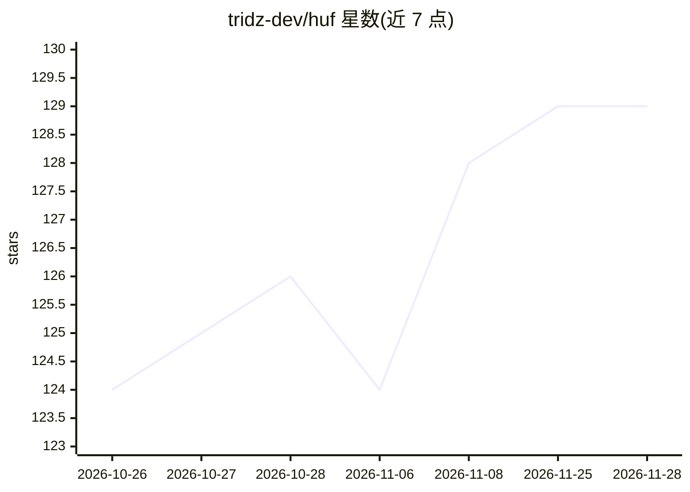

# tridz-dev/huf

⭐ 129 · Python · AGPL-3.0 · 推送 2026-11-27 · [GitHub](https://github.com/tridz-dev/huf) · [官网](https://huf.ai/) · 组织维护

**自托管多智能体 AI 基础设施层，供团队与企业构建代理工作流**

基于 Frappe 框架的自托管 AI 基础设施：提供带工具、知识库与持久记忆的智能体系统，可视化流程编排（含人工审批节点）、事件驱动触发器、多渠道消息网关（Telegram/Slack/WhatsApp/Gmail/Webhook），以及可插拔的代码执行沙箱（本地 venv/SSH/Docker）。知识检索支持 BM25 全文与 ChromaDB/pgvector 向量混合搜索。面向需要将 AI 接入 ERP 等业务系统并保留数据自主权的团队与产品开发者。当前处于 beta 阶段，通过 bench migrate 升级。

## 筛选速览

| 维度 | 判定 | 备注 |
|---|---|---|
| AI 角色 | `ai-ecosystem` | LLM/agent 周边工具 |
| 许可风险 | `viral` | AGPL-3.0 |
| 部署形态 | `self-host` | docker 或自建部署 |
| 模型依赖 | local-ok | 支持本地模型 |
| 硬件要求 | — | 无带数字的原话,不猜 |
| 安装摩擦 | `low` | 无编译、无系统依赖或容器化 |
| 成熟度 | `idea` | |

## 能力要点

- 多智能体系统：代理链、角色权限、作用域记忆与提示缓存分析
- 可插拔执行沙箱：本地 venv、SSH、Docker 容器运行代码工具
- 多渠道网关接入 Telegram/Slack/WhatsApp/Gmail，支持事件驱动触发
- 混合知识检索：FTS5 BM25 + ChromaDB + pgvector

## 适用场景

- 为内部运营/HR/销售构建基于公司文档与 ERP 数据的助手
- 将 HUF 作为 SaaS 产品的后端 AI 引擎嵌入应用
- 搭建带人工审批的多步骤业务自动化流程

## 场景标签

`多智能体` `Agent 框架` `工作流自动化` · 领域:Agent 开发

## 证据(README 行号)

> L5: HUF is a complete, self-hosted AI layer built on open standards. It gives teams everything needed to create intellig
> L48: |**Universal AI Access**|Connect to major cloud providers or local models — with unified routing and open-router fr
> L55: |**Visual Flow Builder**|Design complex multi-step workflows with React Flow / XYFlow, router nodes, and Human-in-t

## 星数曲线

2026-10-26 124 → 2026-11-28 129（+5）

---
*卡片 v1 · prompt 1.4 · 生成 2026-11-28 · 置信度 high · 依据 README sha `3f22d8130b1b` · [字段定义](../../DATASET.md)*
