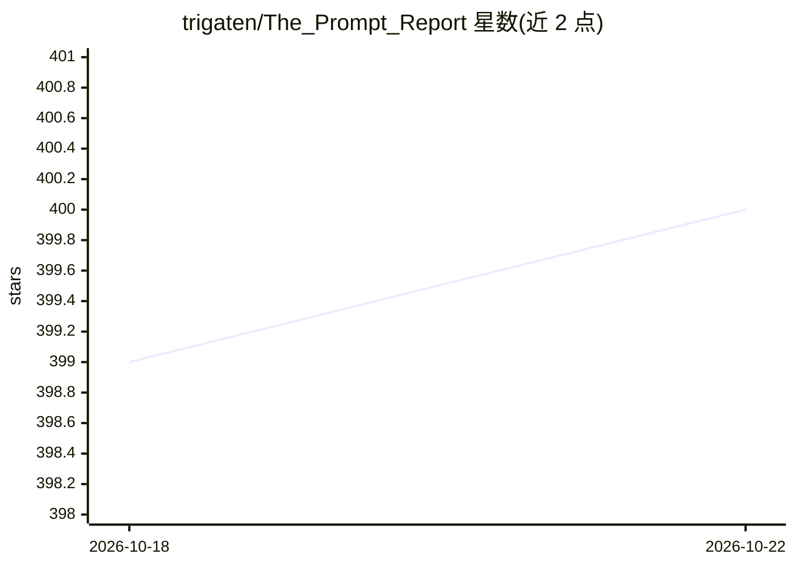

# trigaten/The_Prompt_Report

⭐ 400 · HTML · MIT · 推送 2026-02-25 · [GitHub](https://github.com/trigaten/The_Prompt_Report) · [官网](https://trigaten.github.io/Prompt_Survey_Site/) · 组织维护

**The Prompt Report 研究代码：提示技术的系统性综述与实验**

论文 The Prompt Report 的配套代码库，实现提示技术分类学研究的自动化流程：下载论文、去重过滤、运行自动化审阅（关键词可调），并执行实验脚本；数据集托管在 Hugging Face。面向 prompt 工程方向的科研人员，通过克隆仓库、pip 安装依赖并配置 OpenAI/Hugging Face/Semantic Scholar 的 API key 运行 main.py 完成全流程，也可单独运行各实验脚本；配套论文在 arXiv。

## 筛选速览

| 维度 | 判定 | 备注 |
|---|---|---|
| AI 角色 | `ai-knowledge` | 知识聚合/清单类 |
| 许可风险 | `permissive` | MIT |
| 部署形态 | `library` | 以包/库形式分发 |
| 模型依赖 | — | README 未给出锁定关系 |
| 硬件要求 | — | 无带数字的原话,不猜 |
| 安装摩擦 | `low` | 无编译、无系统依赖或容器化 |
| 成熟度 | — | 结构信号不足 |

## 能力要点

- main.py 一键完成论文下载、去重过滤、自动化审阅与实验
- 自动化审阅关键词可在 keywords.py 中自定义
- 数据集在 Hugging Face 公开，可下载后仅运行实验

## 适用场景

- 复现 The Prompt Report 的系统性综述流程
- 调整关键词后对其他论文集做自动化审阅
- 基于公开数据集运行或扩展提示技术实验

## 场景标签

 · 领域:提示工程/学术研究

## 证据(README 行号)

> L6: area’s nascency. This repository is the code for The Prompt Report, our research that establishes a structured
> L8: allows for the automated review of papers, the collection of data, and the running of experiments. Our dataset

## 星数曲线

2026-10-18 399 → 2026-10-22 400（+1）

---
*卡片 v1 · prompt 1.4 · 生成 2026-10-21 · 置信度 high · 依据 README sha `248e03e04a11` · [字段定义](../../DATASET.md)*
