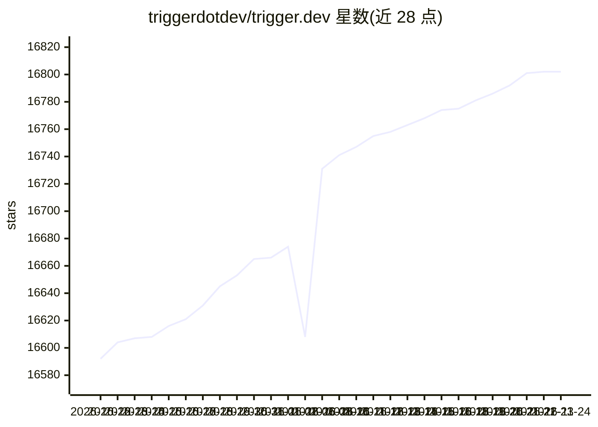

# triggerdotdev/trigger.dev

⭐ 16,802 · TypeScript · Apache-2.0 · 推送 2026-11-21 · [GitHub](https://github.com/triggerdotdev/trigger.dev) · [官网](https://trigger.dev/changelog) · 组织维护

**给开发者的 TypeScript 长时运行 AI agent 工作流平台**

开源平台，用 TypeScript 编写 AI 工作流与 agent 任务，部署到其托管云或自行托管。核心机制包括无超时的长时任务、自动重试、队列与幂等、检查点、任务版本控制、LLM 调用可观测性（模型/token/成本/延迟记录为 trace span）、human-in-the-loop 暂停等待人工审批、实时流式输出与 dashboard。提供 JS/TS SDK、React hooks、TRQL 查询语言与 MCP server；可通过 Docker Compose 或 Kubernetes Helm chart 自托管。

## 筛选速览

| 维度 | 判定 | 备注 |
|---|---|---|
| AI 角色 | `ai-ecosystem` | LLM/agent 周边工具 |
| 许可风险 | `permissive` | Apache-2.0 |
| 部署形态 | `self-host` | docker 或自建部署 |
| 模型依赖 | — | README 未给出锁定关系 |
| 硬件要求 | — | 无带数字的原话,不猜 |
| 安装摩擦 | `low` | 无编译、无系统依赖或容器化 |
| 成熟度 | — | 结构信号不足 |

## 动量与使用信号

- 维护:`active` — 距上次 push 1.0 天,年发版 100,145 位贡献者
- 涨星:近 1 天 **+11**(自 20261016 起算)

## 能力要点

- 无超时长时任务，带重试、队列、幂等与检查点
- LLM observability：记录模型、token 用量、成本与延迟
- MCP server 使 AI 助手可直接操作项目
- 支持 Docker Compose 与 Kubernetes Helm chart 自托管

## 适用场景

- 为应用构建可靠的多轮 AI chat agent 与后台工作流
- 需要人工审批环节的自动化流程
- 跟踪每次任务运行的 LLM token 成本与延迟
- 替代传统 serverless 平台运行超时受限的长任务

## 场景标签

`工作流自动化` `Agent 框架` `LLM 可观测性` · 领域:Agent 开发

## 证据(README 行号)

> L19: Trigger.dev is the open-source platform for building AI workflows in TypeScript. Long-running tasks with retries, q
> L23: Build AI agents using all the frameworks, services and LLMs you're used to, deploy them to Trigger.dev and get dura

## 星数曲线

2026-10-22 16,592 → 2026-11-24 16,802（+210）

---
*卡片 v1 · prompt 1.4 · 生成 2026-11-22 · 置信度 high · 依据 README sha `8292da59884c` · [字段定义](../../DATASET.md)*
