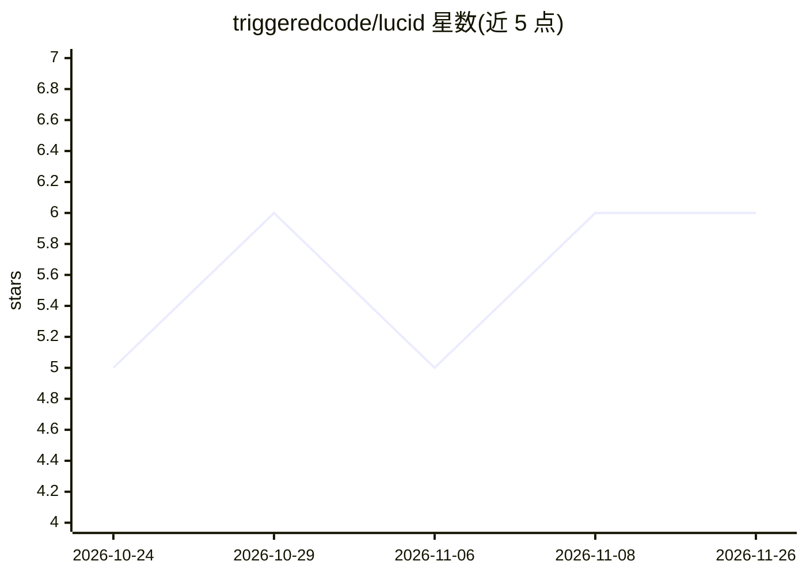

# triggeredcode/lucid

⭐ — · [GitHub]() · 个人维护

**语音转结构化笔记与图表的本地优先辅助工具**

面向无法舒适打字或单手操作的用户，将口述文本整理为带标题、列表、表格与图表的结构化笔记页面，并排版导出 PDF。依赖外部听写应用粘贴文字，本地运行的语言模型（LM Studio 中如 Qwen）始终持有页面与历史上下文，负责归类内容与生成块；每次修改是一个撤销步骤。提供分阶段引导的图表构建、命令模式、历史回溯、Edit mode 手动编辑，并内置 MCP 服务器供 AI agent 读写页面。提供 macOS/Windows/Linux 安装包，需自备 LM Studio 与指定模型。

## 筛选速览

| 维度 | 判定 | 备注 |
|---|---|---|
| AI 角色 | `ai-native` | 本体是模型或模型工具 |
| 许可风险 | `permissive` | — |
| 部署形态 | `desktop` | 安装包/桌面程序 |
| 模型依赖 | — | README 未给出锁定关系 |
| 硬件要求 | — | 无带数字的原话,不猜 |
| 安装摩擦 | `low` | 无编译、无系统依赖或容器化 |
| 成熟度 | — | 结构信号不足 |

## 能力要点

- 本地模型持有页面与历史上下文，增量整理为标题/列表/表格/图表块
- 三阶段引导式图表构建：关键词、逐条连接、按编号语音编辑
- 内置 MCP 服务器，AI agent 可读取并添加页面内容
- 导出 PDF（本地排版）与 Markdown，整份笔记含历史可备份迁移

## 适用场景

- 双手不便时用语音记笔记和学习系统设计
- 边讲述边生成系统架构图并逐条修正
- AI agent 通过 MCP 读写我的笔记页

## 场景标签

`知识库管理` · 领域:知识与检索

## 证据(README 行号)

> L4:  Talk, and Lucid builds the headings, lists, tables and diagrams while you think, then typesets a PDF.
> L36:   box --> model["A local model in LM Studio (for example Qwen 3.8) sees the page and its history"]
> L101: An AI agent such as Claude Code can read your pages and add to them. Each change is one undo step and shows in the

## 星数曲线

2026-10-24 5 → 2026-11-26 6（+1）

---
*卡片 v1 · prompt 1.4 · 生成 2026-11-21 · 置信度 high · 依据 README sha `20e4027cac42` · [字段定义](../../DATASET.md)*
