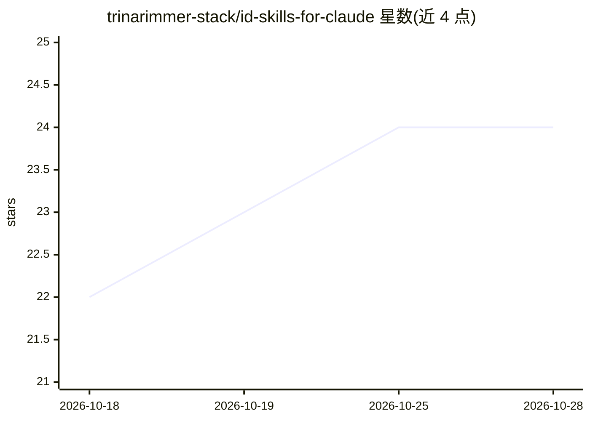

# trinarimmer-stack/id-skills-for-claude

⭐ 24 · 推送 2026-03-31 · [GitHub](https://github.com/trinarimmer-stack/id-skills-for-claude) · 个人维护

**给教学设计者的 Claude 技能文件库，赋予领域思维框架**

面向教学设计师（ID）与 L&D 从业者的免费开源技能文件合集：以结构化知识文档（非普通 prompt）形式，向 Claude 及其他支持自定义指令的 AI 助手传授教学设计领域的框架、术语与判断标准，使其充当设计思考伙伴。内容覆盖需求分析、ADDIE/SAM 等模型、场景化学习、评估设计、无障碍、QA、AI 协作姿势等约 30 个文件。使用方式为粘贴到上下文、设为 system prompt 或作为 OpenClaw 类工具的技能文件加载。

## 筛选速览

| 维度 | 判定 | 备注 |
|---|---|---|
| AI 角色 | `ai-knowledge` | 知识聚合/清单类 |
| 许可风险 | `none` | — |
| 部署形态 | `None` |  |
| 模型依赖 | locked-api |  |
| 硬件要求 | — | 无带数字的原话,不猜 |
| 安装摩擦 | `low` | 无编译、无系统依赖或容器化 |
| 成熟度 | — | 结构信号不足 |

## 能力要点

- 约 30 个结构化技能文件，覆盖需求分析/设计模型/评估/无障碍/QA 等 ID 领域
- 声明为技能文件而非普通 prompt，教授领域框架与判断
- 兼容任意支持自定义指令的 AI 助手，可作为 OpenClaw 类工具的 drop-in 技能
- 针对 Claude Projects 与普通聊天给出不同的加载规则说明

## 适用场景

- 教学设计师让 Claude 以领域伙伴身份参与需求分析与课程设计
- L&D 团队在多个项目中获得一致的 AI 辅助设计支持
- 为 e-learning 课程的评估、无障碍与 QA 环节加载对应技能文件

## 场景标签

`提示工程` · 领域:Agent 开发

## 证据(README 行号)

> L16: These are not prompts. They are **skill files** —
> L22: Load one (or several) into your AI assistant's

## 星数曲线

2026-10-18 22 → 2026-10-28 24（+2）

---
*卡片 v1 · prompt 1.4 · 生成 2026-10-27 · 置信度 high · 依据 README sha `a15133952645` · [字段定义](../../DATASET.md)*
