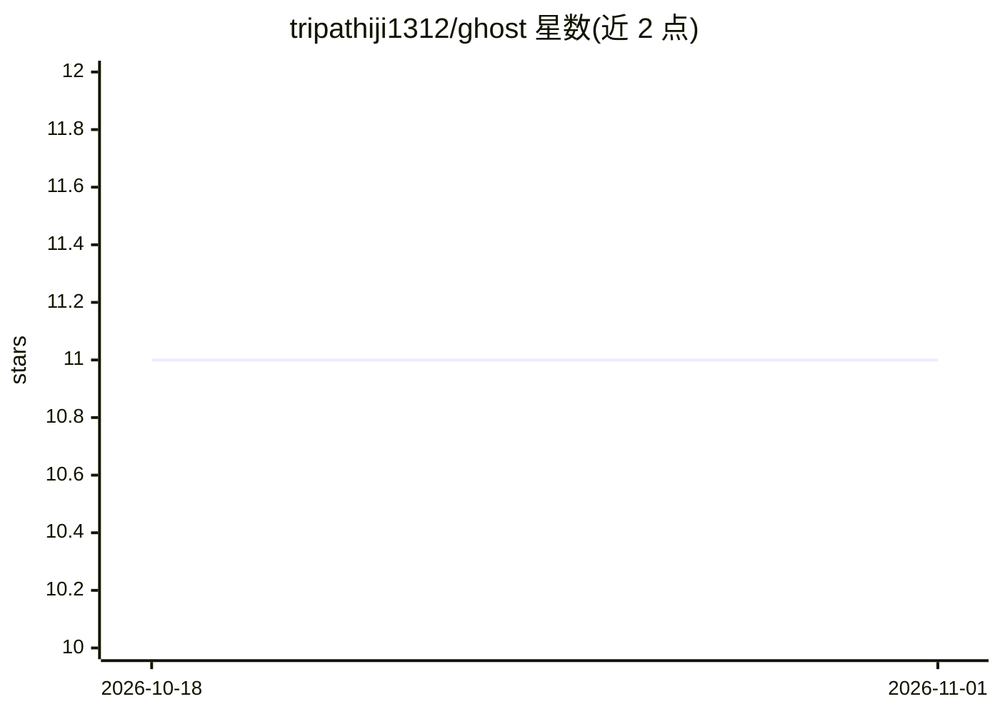

# tripathiji1312/ghost

⭐ 11 · Python · MIT · 推送 2026-06-18 · [GitHub](https://github.com/tripathiji1312/ghost) · [官网](https://ghostest.vercel.app/) · 个人维护

**本地优先的 AI Agent：自动生成并自愈 Python 单元测试**

以后台守护进程形式运行的 Python 单元测试自动化 Agent：监控文件系统事件，解析 AST 构建依赖图，生成 pytest 测试套件并在安全子进程中执行；测试失败时捕获错误回传 LLM 自动修补（自愈引擎）。设有"Judge"二次校验协议，判定源码可疑时停止并告警而非篡改测试预期。原生支持 Ollama、LM Studio 本地运行，也支持 Groq/OpenAI/Anthropic，通过 PyPI 以 pip 或 uv 安装，提供 ghost init/watch/generate 等 CLI 命令。

## 筛选速览

| 维度 | 判定 | 备注 |
|---|---|---|
| AI 角色 | `ai-ecosystem` | LLM/agent 周边工具 |
| 许可风险 | `permissive` | MIT |
| 部署形态 | `library` | 以包/库形式分发 |
| 模型依赖 | local-ok | 支持本地模型 |
| 硬件要求 | — | 无带数字的原话,不猜 |
| 安装摩擦 | `low` | 无编译、无系统依赖或容器化 |
| 成熟度 | — | 结构信号不足 |

## 能力要点

- 文件监控 + AST 依赖分析生成上下文感知的测试套件
- 自愈引擎：捕获错误回传 LLM 自动修补并复跑验证
- Judge 协议区分语法错误与断言错误，疑似源码缺陷时停止并告警
- 支持 Ollama/LM Studio 本地模型，源码不离开本机

## 适用场景

- 开发过程中自动为改动的 Python 文件生成并维护单元测试
- 在不将代码发送到云端的前提下用本地模型做测试生成
- 持续监听项目变更、自动修补失败测试的 CI 前置环节

## 场景标签

`编码 Agent` `代码生成` · 领域:编码与开发

## 证据(README 行号)

> L12: Ghost is a **local-first AI Agent** designed to automate the unit testing lifecycle for Python applications. It fun
> L14: Unlike standard code generators, Ghost employs a **continuous feedback loop**. When source code changes, Ghost anal
> L16: It is designed for privacy and speed, with native support for **Ollama** (local LLMs), **Groq** (low-latency infere

## 星数曲线

2026-10-18 11 → 2026-11-01 11（+0）

---
*卡片 v1 · prompt 1.4 · 生成 2026-11-01 · 置信度 high · 依据 README sha `f3fc4ec26a98` · [字段定义](../../DATASET.md)*
