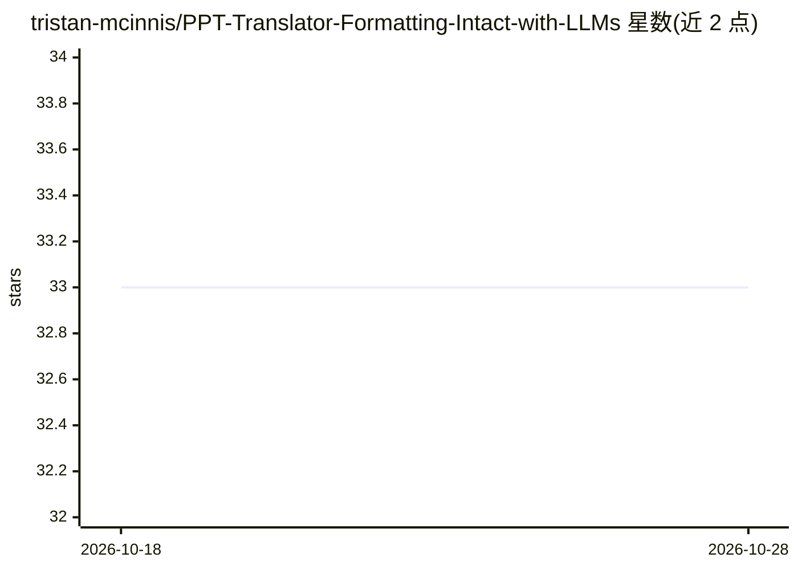

# tristan-mcinnis/PPT-Translator-Formatting-Intact-with-LLMs

⭐ 33 · Python · 推送 2026-08-23 · [GitHub](https://github.com/tristan-mcinnis/PPT-Translator-Formatting-Intact-with-LLMs) · 个人维护

**用 LLM 翻译 PowerPoint 并保留原格式的 CLI 工具**

Python 命令行工具，读取 PowerPoint，将每页文本以 JSON 模式批量发给 LLM 翻译，重建为保留字体、颜色、表格与版式的 pptx。支持 DeepSeek（默认）、OpenAI、Anthropic、Grok、Gemini 五个提供方，通过环境变量配置 API key 并以 --provider 切换。提供重复字符串缓存、目录批量处理、脚本感知过滤与可选的视觉审计（LibreOffice 渲染幻灯片后由视觉模型检查溢出/截断）。另含可复制到其他项目的 Claude Agent Skill 目录。需 Python 3.10+，视觉审计依赖 LibreOffice 与 pdftoppm（可选）。

## 筛选速览

| 维度 | 判定 | 备注 |
|---|---|---|
| AI 角色 | `ai-native` | 本体是模型或模型工具 |
| 许可风险 | `none` | — |
| 部署形态 | `library` | 以包/库形式分发 |
| 模型依赖 | locked-api |  |
| 硬件要求 | — | 无带数字的原话,不猜 |
| 安装摩擦 | `low` | 无编译、无系统依赖或容器化 |
| 成熟度 | — | 结构信号不足 |

## 能力要点

- 翻译后保留字体、颜色、间距、表格与对齐等格式
- 五种提供方（DeepSeek/OpenAI/Anthropic/Grok/Gemini）CLI 切换
- 可选视觉审计：渲染每页并让视觉模型检查溢出/截断/乱码
- 重复字符串缓存与目录批量处理

## 适用场景

- 把整套演示文稿翻译成另一种语言且不改版式
- 批量翻译目录下的多个 PPT 文件
- 翻译后用视觉模型自动检查排版缺陷

## 场景标签

 · 领域:办公文档/机器翻译

## 证据(README 行号)

> L9: *Clean, fast, and reliable PowerPoint translation with multi-provider support and formatting preservation*
> L99: 3. `{deck}_translated.pptx` – rebuilt presentation with translated text and formatting intact.

## 星数曲线

2026-10-18 33 → 2026-10-28 33（+0）

---
*卡片 v1 · prompt 1.4 · 生成 2026-10-25 · 置信度 mid · 依据 README sha `13ebb545f69b` · [字段定义](../../DATASET.md)*
