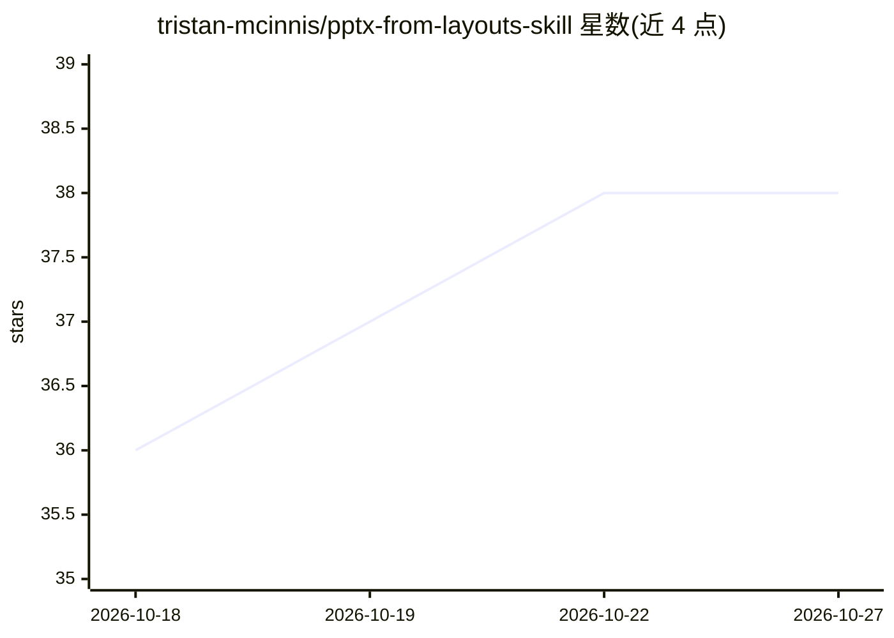

# tristan-mcinnis/pptx-from-layouts-skill

⭐ 38 · Python · MIT · 推送 2026-08-30 · [GitHub](https://github.com/tristan-mcinnis/pptx-from-layouts-skill) · 个人维护

**按模板母版布局从 Markdown 生成 PPT 的 Claude Code 技能**

面向 Claude Code 等 coding agent 的技能包，分三步生成演示文稿：pptx-profile 解析 .pptx 模板的母版布局生成布局目录，pptx-author 将内容标记为 [HINT: layout] 的大纲，pptx-from-layouts 填充到实际占位符输出 deck.pptx。内容放入模板既有占位符而非叠加文本框，附三个子代理（大纲架构/模板接入/QA）与编辑、重排、校验脚本，捆绑 Inner Chapter 演示模板，可一次性接入自有企业模板复用。需 Python 3.10+、python-pptx、pydantic。

## 筛选速览

| 维度 | 判定 | 备注 |
|---|---|---|
| AI 角色 | `ai-ecosystem` | LLM/agent 周边工具 |
| 许可风险 | `permissive` | MIT |
| 部署形态 | `library` | 以包/库形式分发 |
| 模型依赖 | — | README 未给出锁定关系 |
| 硬件要求 | — | 无带数字的原话,不猜 |
| 安装摩擦 | `low` | 无编译、无系统依赖或容器化 |
| 成熟度 | — | 结构信号不足 |

## 能力要点

- 三步流水线：模板画像→大纲标注→按母版布局渲染
- 通过 [HINT: layout_name] 将语义内容映射到模板真实布局
- 附 pptx-outline-architect / template-onboarder / deck-qas 三个子代理
- edit.py 支持对既有文稿的局部修改与幻灯片重排

## 适用场景

- 用自有企业模板从 Markdown 大纲生成符合品牌规范的 PPT
- 让 Claude Code 等 coding agent 代为撰写和渲染演示文稿
- 对已生成的 deck 做小范围修改或幻灯片重排

## 场景标签

 · 领域:办公文档生成/agent 技能

## 证据(README 行号)

> L51: Paste this into Claude Code, Codex, OpenCode, or any other coding agent and it'll
> L147: The skill ships three subagents (in `.claude/skills/pptx-from-layouts/agents/`,
> L24: Decks are built in three mapped steps — each is its own skill, so you can run

## 星数曲线

2026-10-18 36 → 2026-10-27 38（+2）

---
*卡片 v1 · prompt 1.4 · 生成 2026-10-25 · 置信度 mid · 依据 README sha `0e4ba28a4a86` · [字段定义](../../DATASET.md)*
