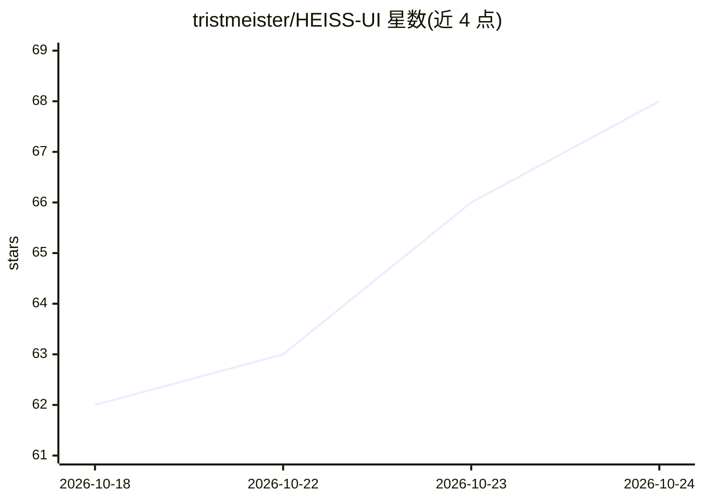

# tristmeister/HEISS-UI

⭐ 68 · JavaScript · MIT · 推送 2026-10-21 · [GitHub](https://github.com/tristmeister/HEISS-UI) · [官网](https://heiss-ui.vercel.app/) · 个人维护

**ComfyUI 的本地简洁前端：免节点图写提示词生成图像/视频**

运行在用户已有 ComfyUI 之上的本地前端：提供提示词输入框、画廊与按模型整理的设置，ComfyUI 仍负责执行任务并保留节点、模型与输出。内置 30 个模型家族的推荐设置，支持导入自定义 ComfyUI 工作流并转为控件、局部重绘、原生 2K、SeedVR2 一键放大、组件自动下载与多设备（手机/局域网）访问。以 Windows/macOS(Apple Silicon)/Linux 打包 zip 发布，需本机或局域网内运行 ComfyUI。

## 筛选速览

| 维度 | 判定 | 备注 |
|---|---|---|
| AI 角色 | `ai-native` | 本体是模型或模型工具 |
| 许可风险 | `permissive` | MIT |
| 部署形态 | `self-host` | docker 或自建部署 |
| 模型依赖 | — | README 未给出锁定关系 |
| 硬件要求 | — | 无带数字的原话,不猜 |
| 安装摩擦 | `low` | 无编译、无系统依赖或容器化 |
| 成熟度 | `idea` | |

## 能力要点

- 30 个模型家族开箱即用，含 SDXL、Flux.2、Qwen-Image、Wan 2.2 等
- 导入自有 ComfyUI 工作流并转为控件，图在底层运行
- 原生 2K 生成与 SeedVR2 一键放大至 2K/4K
- 局部重绘（beta），支持 18 个图像家族，无需额外节点

## 适用场景

- 不想面对节点图、只想写提示词出图的 ComfyUI 用户
- 在手机和平板上远程使用 PC 上的 ComfyUI
- 把自制工作流封装成简洁界面供日常使用

## 场景标签

`图像生成` `视频生成` · 领域:内容生成

## 证据(README 行号)

> L19: HEISS UI sits on top of the ComfyUI you already run. You get a prompt box, a gallery and the settings that matter f
> L25: - **30 model families, ready to go.** From SD 1.5 and SDXL to Flux.2, Qwen-Image, Krea 2 and Wan 2.2, each with its
> L43: **1. Download** the zip for your system from the latest release:

## 星数曲线

2026-10-18 62 → 2026-10-24 68（+6）

---
*卡片 v1 · prompt 1.4 · 生成 2026-10-24 · 置信度 high · 依据 README sha `8a3540c9fe98` · [字段定义](../../DATASET.md)*
