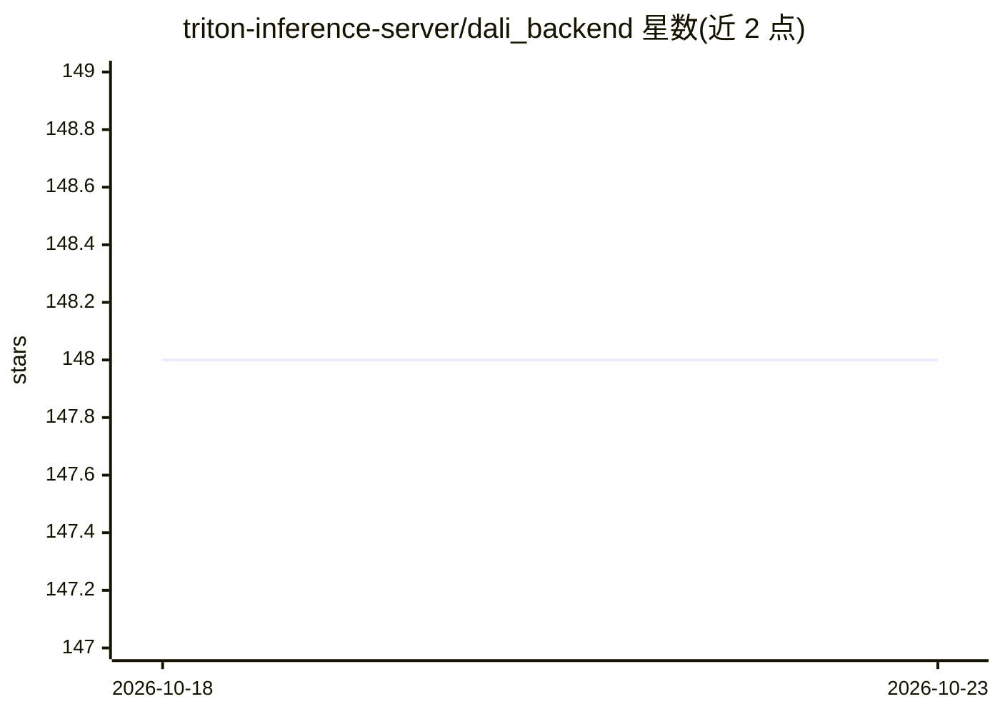

# triton-inference-server/dali_backend

⭐ 148 · C++ · MIT · 推送 2026-10-15 · [GitHub](https://github.com/triton-inference-server/dali_backend) · [官网](https://docs.nvidia.com/deeplearning/dali/user-guide/docs/index.html) · 组织维护

**Triton 推理服务器的 DALI 后端：运行 GPU 加速数据预处理流水线**

为 Triton Inference Server 提供 DALI 后端，使其能以 Model 形式运行用 DALI Python API 编写的 GPU 加速数据预处理流水线（如图像解码与 resize）。用户将流水线序列化为 model.dali 或以 @autoserialize 装饰的 dali.py 放入 Model Repository，Triton 可从流水线元数据自动补全 max_batch_size、input/output 配置。已知限制：ImageDecoder 仅接受 CPU 输入、Triton 仅支持同构 batch 形状、instance group count 大于 1 时内存消耗可能增加。提供 Docker 与 CMake 两种构建方式。

## 筛选速览

| 维度 | 判定 | 备注 |
|---|---|---|
| AI 角色 | `ai-ecosystem` | LLM/agent 周边工具 |
| 许可风险 | `permissive` | MIT |
| 部署形态 | `self-host` | docker 或自建部署 |
| 模型依赖 | — | README 未给出锁定关系 |
| 硬件要求 | — | 无带数字的原话,不猜 |
| 安装摩擦 | `low` | 无编译、无系统依赖或容器化 |
| 成熟度 | — | 结构信号不足 |

## 能力要点

- 在 Triton 中以 Model 形式运行 DALI 预处理流水线
- Autoserialization：Model Repository 中直接放 Python 流水线定义，免手动序列化
- 配置自动补全：从流水线定义推断 input/output 与 max_batch_size

## 适用场景

- 推理服务中把图像解码/缩放等预处理与模型一同部署在 Triton
- 用 Python 定义 DALI 流水线并纳入 Triton Model Repository 管理
- 自建含 DALI 后端的 tritonserver Docker 镜像

## 场景标签

 · 领域:深度学习基础设施/数据预处理

## 证据(README 行号)

> L3: This repository contains code for DALI Backend for Triton Inference Server.
> L24: 1. DALI data pipeline is expressed within Triton as a
> L120: When using DALI Backend in Triton, user has to provide a DALI model in the Model Repository.

## 星数曲线

2026-10-18 148 → 2026-10-23 148（+0）

---
*卡片 v1 · prompt 1.4 · 生成 2026-10-22 · 置信度 high · 依据 README sha `c5a752b541fa` · [字段定义](../../DATASET.md)*
