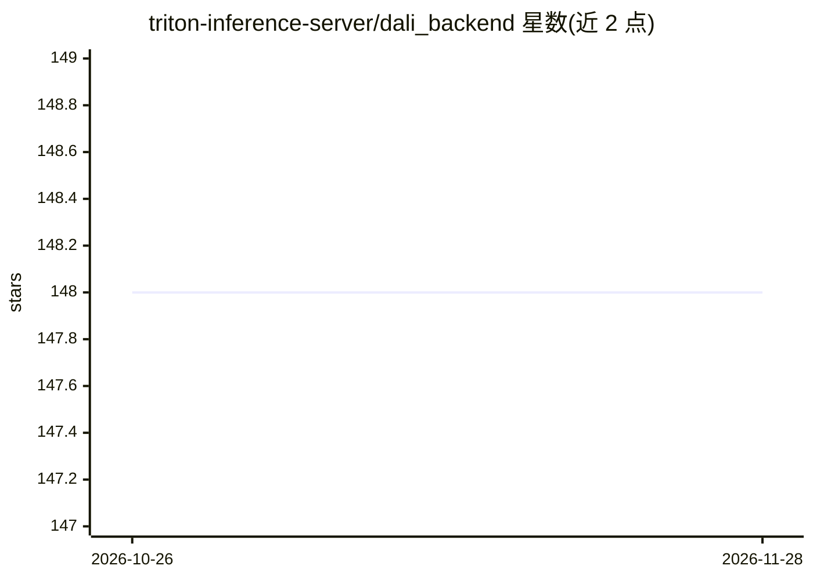

# triton-inference-server/dali_backend

⭐ 148 · C++ · MIT · 推送 2026-11-19 · [GitHub](https://github.com/triton-inference-server/dali_backend) · [官网](https://docs.nvidia.com/deeplearning/dali/user-guide/docs/index.html) · 组织维护

**让 Triton 推理服务器运行 DALI GPU 数据预处理管线的后端**

NVIDIA 官方维护的 Triton Inference Server 后端，使用户能把 DALI Python API 编写的数据预处理管线作为 Triton Model 部署运行。核心机制：用户以 Python 定义 DALI Pipeline 并序列化（或使用 @autoserialize 自动序列化）放入 Triton Model Repository；后端支持配置自动补全、部分配置覆盖、加载优先级规则。限制包括 ImageDecoder 仅接受 CPU 输入、仅支持通过 external_source 传入数据、batch 需同构形状。通过 Docker 或 CMake 源码构建。

## 筛选速览

| 维度 | 判定 | 备注 |
|---|---|---|
| AI 角色 | `ai-ecosystem` | LLM/agent 周边工具 |
| 许可风险 | `permissive` | MIT |
| 部署形态 | `self-host` | docker 或自建部署 |
| 模型依赖 | — | README 未给出锁定关系 |
| 硬件要求 | — | 无带数字的原话,不猜 |
| 安装摩擦 | `low` | 无编译、无系统依赖或容器化 |
| 成熟度 | — | 结构信号不足 |

## 能力要点

- 将 DALI 数据预处理管线作为 Triton Model 部署运行
- @autoserialize 免手动序列化，Python 定义直接放入模型仓库
- 从管线元数据自动补全 config.pbtxt 的 inputs/outputs/max_batch_size
- 支持部分配置覆盖输出命名、形状与 batch 大小

## 适用场景

- 在 Triton 推理服务中前置 GPU 图像解码与缩放预处理
- 用 ensemble 模型把预处理管线与模型推理串联
- 训练或推理管道中加载 DALI 预处理步骤

## 场景标签

`图像视频处理` `推理引擎` · 领域:感知与多模态

## 证据(README 行号)

> L3: This repository contains code for DALI Backend for Triton Inference Server.
> L24: 1. DALI data pipeline is expressed within Triton as a
> L8: and an execution engine, to accelerate the pre-processing of the input data for deep learning applications.

## 星数曲线

2026-10-26 148 → 2026-11-28 148（+0）

---
*卡片 v1 · prompt 1.4 · 生成 2026-11-27 · 置信度 high · 依据 README sha `fb5a6176313c` · [字段定义](../../DATASET.md)*
