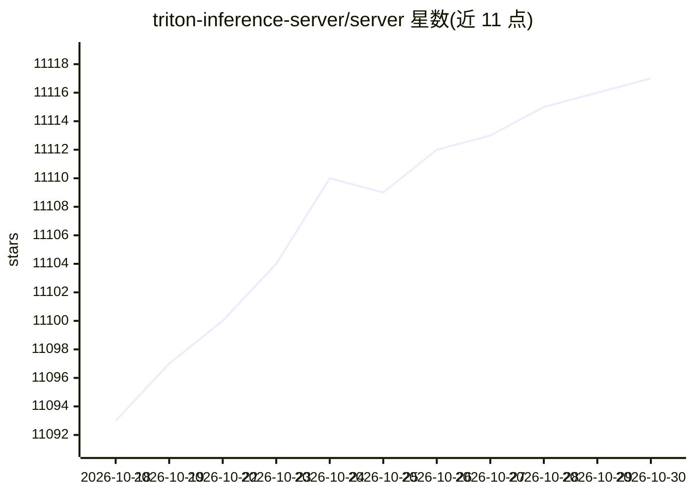

# triton-inference-server/server

⭐ 11,117 · Python · BSD-3-Clause · 推送 2026-10-29 · [GitHub](https://github.com/triton-inference-server/server) · [官网](https://docs.nvidia.com/deeplearning/triton-inference-server/user-guide/docs/index.html) · 组织维护

**给开发/运维：部署多框架 AI 模型的开源推理服务软件**

NVIDIA 维护的开源推理服务软件：从模型仓库加载 TensorRT、PyTorch、ONNX、OpenVINO、Python、RAPIDS FIL 等多框架模型，通过 HTTP/REST 与 gRPC（基于 KServe 协议）提供推理服务，支持动态批处理、序列批处理、并发模型执行、模型集成与 BLS 流水线。可在 NVIDIA GPU、x86/ARM CPU、AWS Inferentia 上跨云、数据中心、边缘设备运行，提供 C API 与 Java API 嵌入应用、GPU 利用率等指标，以及 Python/C++ 客户端库。推荐以 Docker 容器方式安装使用，属 NVIDIA AI Enterprise 套件组成部分。

## 筛选速览

| 维度 | 判定 | 备注 |
|---|---|---|
| AI 角色 | `ai-ecosystem` | LLM/agent 周边工具 |
| 许可风险 | `permissive` | BSD-3-Clause |
| 部署形态 | `None` |  |
| 模型依赖 | — | README 未给出锁定关系 |
| 硬件要求 | — | 无带数字的原话,不猜 |
| 安装摩擦 | `medium` | 含编译或系统依赖之一 |
| 成熟度 | — | 结构信号不足 |

## 能力要点

- 多深度学习/机器学习框架后端（TensorRT/PyTorch/ONNX/OpenVINO/Python 等）
- 动态批处理、并发模型执行与模型集成/BLS 流水线
- HTTP/REST 与 gRPC 推理协议（基于 KServe v2 协议），含 Python/C++ 客户端库
- 支持 NVIDIA GPU、x86/ARM CPU、AWS Inferentia，可部署于云/数据中心/边缘

## 适用场景

- 在生产环境部署和服务多框架训练出的 AI 模型
- 通过动态批处理与并发执行提升推理吞吐
- 以 Docker/Kubernetes 在云或数据中心搭建推理服务
- 在边缘/嵌入式设备上运行推理（C API 进程内链接）

## 场景标签

`推理引擎` · 领域:训练与推理

## 证据(README 行号)

> L10: Triton Inference Server is an open source inference serving software that
> L11: streamlines AI inferencing. Triton enables teams to deploy any AI model from

## 星数曲线

2026-10-18 11,093 → 2026-10-30 11,117（+24）

---
*卡片 v1 · prompt 1.4 · 生成 2026-10-20 · 置信度 high · 依据 README sha `0d2ae126cdc6` · [字段定义](../../DATASET.md)*
