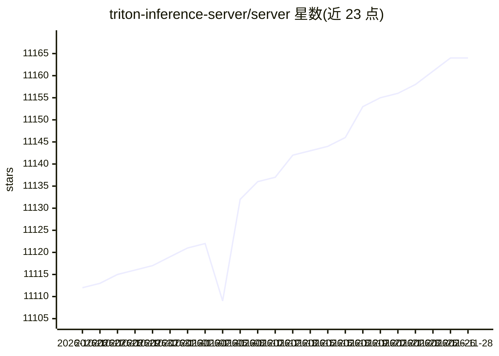

# triton-inference-server/server

⭐ 11,164 · Python · BSD-3-Clause · 推送 2026-11-26 · [GitHub](https://github.com/triton-inference-server/server) · [官网](https://docs.nvidia.com/deeplearning/triton-inference-server/user-guide/docs/index.html) · 组织维护

**面向云/边/数据中心的模型推理服务运行时**

开源推理服务软件，用于将来自多种框架（TensorRT、PyTorch、ONNX、OpenVINO、Python、RAPIDS FIL 等）的模型部署为服务，支持 NVIDIA GPU、x86/ARM CPU 与 AWS Inferentia。提供并发模型执行、动态批处理、序列批处理、模型编排（Ensembling/BLS）、HTTP/REST 与 gRPC 推理协议（基于 KServe 协议）、C API 与 Java API 进程内集成，以及 GPU 利用率、吞吐与延迟指标。当前版本 2.75.0，对应 NGC 26.11 容器发布。

## 筛选速览

| 维度 | 判定 | 备注 |
|---|---|---|
| AI 角色 | `ai-ecosystem` | LLM/agent 周边工具 |
| 许可风险 | `permissive` | BSD-3-Clause |
| 部署形态 | `None` |  |
| 模型依赖 | — | README 未给出锁定关系 |
| 硬件要求 | `cpu-ok` | |
| 安装摩擦 | `medium` | 含编译或系统依赖之一 |
| 成熟度 | — | 结构信号不足 |

## 能力要点

- 多框架后端（TensorRT/PyTorch/ONNX/OpenVINO/Python 等）与 Backend API 自定义扩展
- 动态批处理、序列批处理与模型 Ensemble/BLS 流水线
- HTTP/REST 与 gRPC 推理协议，提供 Python/C++/Java 客户端库
- GPU 利用率、吞吐、延迟等指标，配 Model Analyzer 与 Performance Analyzer

## 适用场景

- 把多个框架训练的模型统一部署为云或数据中心的推理服务
- 在 Jetson/边缘设备或 CPU-only 环境运行模型推理
- 用 Kubernetes/Helm 在 GCP/AWS 上部署推理服务
- 对实时、批量与音视频流推理做性能优化与监控

## 场景标签

`推理引擎` · 领域:训练与推理

## 证据(README 行号)

> L10: Triton Inference Server is an open source inference serving software that
> L90: The recommended way to build and use Triton Inference Server is with Docker

## 星数曲线

2026-10-26 11,112 → 2026-11-28 11,164（+52）

---
*卡片 v1 · prompt 1.4 · 生成 2026-11-22 · 置信度 high · 依据 README sha `9cd6e903d34d` · [字段定义](../../DATASET.md)*
