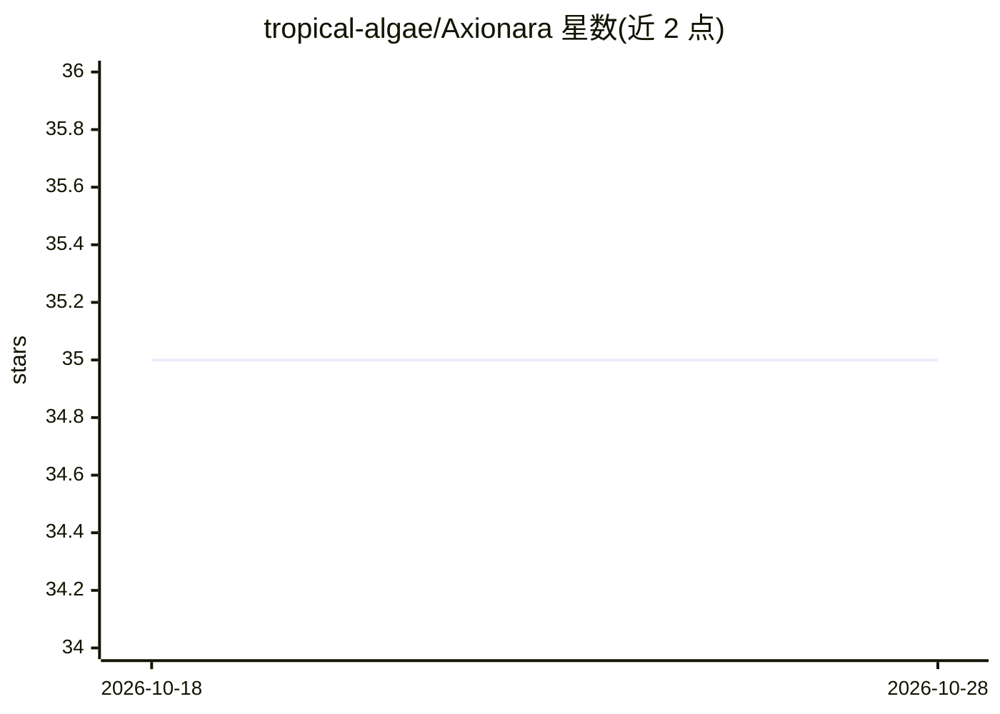

# tropical-algae/Axionara

⭐ 35 · Python · GPL-3.0 · 推送 2026-10-26 · [GitHub](https://github.com/tropical-algae/Axionara) · 组织维护 · 中文 README

**面向政务与组织数据协作的可信数据资产平台（MVP）**

覆盖数据资产全生命周期的全栈平台：数据提供者上传 CSV/PDF/SQL 等文件并登记元数据，后端自动完成解析、统计、清洗建议、敏感性评估与摘要生成，管理员审核后发布至数据市场，使用者获取授权后在个人数据空间检索、问答并导出多格式数据。集成基于 RAG 架构的 Agent 问答，支持对公开画像与授权内容的自然语言探索。通过 Docker 一键部署，模型能力依赖 OpenAI-compatible API 配置，项目自述处于原型验证/MVP 阶段。

## 筛选速览

| 维度 | 判定 | 备注 |
|---|---|---|
| AI 角色 | `ai-enhanced` | 去掉 AI 部分产品仍成立 |
| 许可风险 | `viral` | GPL-3.0 |
| 部署形态 | `self-host` | docker 或自建部署 |
| 模型依赖 | — | README 未给出锁定关系 |
| 硬件要求 | — | 无带数字的原话,不猜 |
| 安装摩擦 | `low` | 无编译、无系统依赖或容器化 |
| 成熟度 | — | 结构信号不足 |

## 能力要点

- 数据资产上传、治理审核、市场发布、授权使用的全流程工作流
- 自动化数据分析：解析、统计、敏感性评估、摘要与标签生成
- 基于 RAG 的 Agent 问答，区分公开画像检索与授权内容检索
- Docker 一体化部署，支持 SQLite 与本地存储的轻量运行

## 适用场景

- 组织内管理数据资产从上传到发布授权的完整流程
- 以自然语言对已授权数据资产进行交互式探索
- 在数据市场中按标签、分类与格式检索并导出数据

## 场景标签

`数据分析` `RAG` `文档解析` · 领域:效率与自动化

## 证据(README 行号)

> L9: 平台内置数据分析模块，并集成基于 RAG 架构的 Agent 问答系统，支持用户以自然语言对多类数据资产进行交互式探索与分析。
> L25: - **Agent 问答能力**：公开市场问答与授权数据问答统一接入 Agent，由工具按需读取公开数据画像、检索市场资产或检索已授权原始内容；

## 星数曲线

2026-10-18 35 → 2026-10-28 35（+0）

---
*卡片 v1 · prompt 1.4 · 生成 2026-10-25 · 置信度 high · 依据 README sha `5c7f9f1fe166` · [字段定义](../../DATASET.md)*
