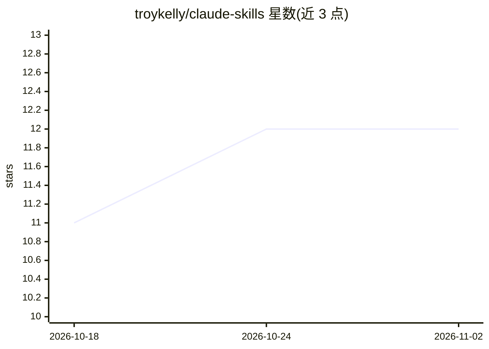

# troykelly/claude-skills

⭐ 12 · Shell · 推送 2026-01-13 · [GitHub](https://github.com/troykelly/claude-skills) · 个人维护

**Claude Code 插件：按 GitHub issue 驱动的自主开发工作流**

面向 Claude Code 用户的插件，包含 51 个技能、9 个专业 agent 与 CLI 工具（claude-autonomous、claude-account）。claude-autonomous 在隔离 git worktree 中自动处理 GitHub 开放 issue：分解任务、按 TDD 开发、创建 PR、监控 CI 并自动合并；支持最多 5 个并行 worker、崩溃自动恢复与会话续跑。claude-account 支持多 Claude 账号免重登切换与计划限额自动轮换。需配置 GitHub Project 环境变量与自定义字段。

## 筛选速览

| 维度 | 判定 | 备注 |
|---|---|---|
| AI 角色 | `ai-ecosystem` | LLM/agent 周边工具 |
| 许可风险 | `none` | — |
| 部署形态 | `library` | 以包/库形式分发 |
| 模型依赖 | locked-api |  |
| 硬件要求 | — | 无带数字的原话,不猜 |
| 安装摩擦 | `low` | 无编译、无系统依赖或容器化 |
| 成熟度 | — | 结构信号不足 |

## 能力要点

- claude-autonomous CLI：自动处理开放 issue 并创建/合并 PR
- 最多 5 个并行 worker 在隔离 git worktree 中工作
- 崩溃自动恢复、crash loop 检测与上限放弃机制
- claude-account 多账号切换与计划限额自动轮换

## 适用场景

- 让 Claude Code 自主消化 GitHub backlog 中的 issue 并产出 PR
- 多账号并行运行 agent 以绕开单一账号计划限额
- 以 TDD 与代码审查流程自动化日常开发任务

## 场景标签

`编码 Agent` · 领域:编码与开发

## 证据(README 行号)

> L8: A Claude Code plugin for autonomous, GitHub-native software development. Work through issues, create PRs, and ship c
> L47: |`claude-autonomous`|Autonomous development with crash recovery, parallel workers, and session management|

## 星数曲线

2026-10-18 11 → 2026-11-02 12（+1）

---
*卡片 v1 · prompt 1.4 · 生成 2026-10-31 · 置信度 mid · 依据 README sha `ca4cd42bdb20` · [字段定义](../../DATASET.md)*
