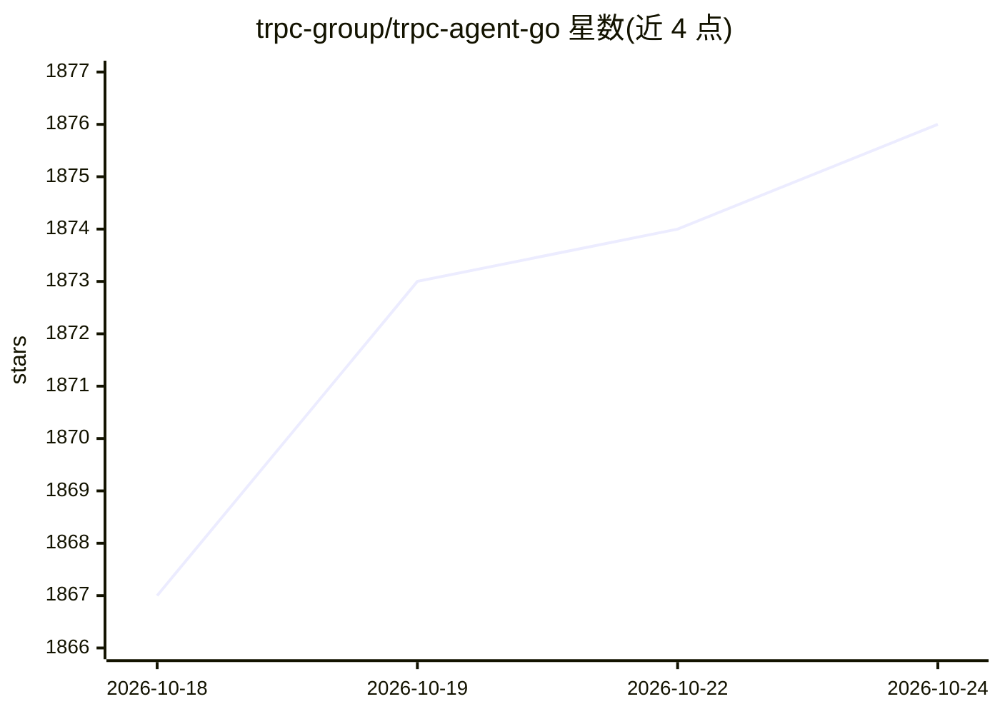

# trpc-group/trpc-agent-go

⭐ 1,876 · Go · Apache-2.0 · 推送 2026-10-23 · [GitHub](https://github.com/trpc-group/trpc-agent-go) · [官网](https://trpc-group.github.io/trpc-agent-go/) · 组织维护 · 中文 README

**面向生产环境的 Go 语言 AI Agent 开发框架**

Go 原生的 agent 系统构建框架，面向希望将 AI agent 嵌入 Go 服务的开发者。提供 LLM agent、类型安全的 GraphAgent 图工作流（README 称功能上相当于 Go 版 LangGraph）、多 agent 编排（Chain/Parallel/Cycle）、函数工具与 MCP 工具、会话与记忆状态、知识检索（RAG）、基于 SKILL.md 的 Agent Skills 与自演化、评测与 OpenTelemetry/Langfuse 可观测性。协议层支持 A2A、AG-UI 与 MCP。要求 Go 1.21 及以上和 LLM provider API key。

## 筛选速览

| 维度 | 判定 | 备注 |
|---|---|---|
| AI 角色 | `ai-ecosystem` | LLM/agent 周边工具 |
| 许可风险 | `permissive` | Apache-2.0 |
| 部署形态 | `None` |  |
| 模型依赖 | — | README 未给出锁定关系 |
| 硬件要求 | — | 无带数字的原话,不猜 |
| 安装摩擦 | `low` | 无编译、无系统依赖或容器化 |
| 成熟度 | — | 结构信号不足 |

## 能力要点

- GraphAgent 类型安全图工作流，支持多条件路由与并行分支
- Chain/Parallel/Cycle 三种多 agent 编排模式
- Agent Skills：SKILL.md 规范、skill_run 隔离执行与会话式交互工具
- A2A、AG-UI、MCP 协议集成，OpenTelemetry + Langfuse 可观测

## 适用场景

- 在 Go 服务中构建可观测、支持流式输出与取消的 LLM agent
- 用图工作流编排多 agent 业务流程（客服、数据分析、DevOps 自动化）
- 构建带 RAG 知识检索与持久记忆的问答 agent
- 对 agent 做可重复的评测与提示词迭代

## 场景标签

`Agent 框架` `多智能体` `RAG` · 领域:Agent 开发

## 证据(README 行号)

> L19: **tRPC-Agent-Go is a Go framework for building production agent systems.**
> L24: Use it when you want agent applications that fit Go services: concurrent,

## 星数曲线

2026-10-18 1,867 → 2026-10-24 1,876（+9）

---
*卡片 v1 · prompt 1.4 · 生成 2026-10-21 · 置信度 high · 依据 README sha `9ae1f7118893` · [字段定义](../../DATASET.md)*
