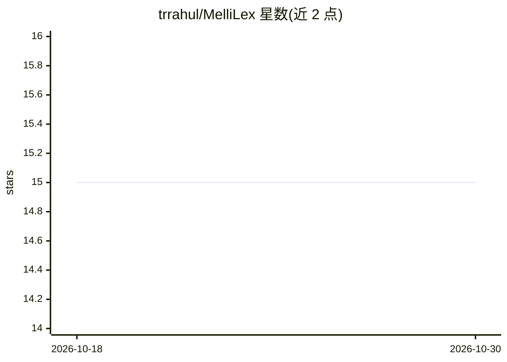

# trrahul/MelliLex

⭐ 15 · Rust · MIT · 推送 2026-05-31 · [GitHub](https://github.com/trrahul/MelliLex) · [官网](https://www.rahultr.dev/mellilex) · 个人维护 · 中文 README

**Windows 桌面 AI 词典：查词、短语与语境探索**

基于 Tauri/Rust 的 Windows 桌面应用，通过 Ctrl+右键即时查询任意单词或短语的含义、用法、正式度与词汇语境。提供 Explore 模式（练习、常见错误、正式度分析、领域探索）、OCR 捕获（支持 Kindle、Adobe Acrobat 等不可选中界面）、SymSpell 拼写纠正、Markdown/Capacities 导出与 11 种界面语言。AI 由用户自选提供商驱动：OpenAI、Anthropic、Google Gemini 或本地 Ollama，需自行填入 API key。仅支持 Windows 10/11，从 Releases 页下载安装包。

## 筛选速览

| 维度 | 判定 | 备注 |
|---|---|---|
| AI 角色 | `ai-native` | 本体是模型或模型工具 |
| 许可风险 | `permissive` | MIT |
| 部署形态 | `desktop` | 安装包/桌面程序 |
| 模型依赖 | local-ok | 支持本地模型 |
| 硬件要求 | — | 无带数字的原话,不猜 |
| 安装摩擦 | `low` | 无编译、无系统依赖或容器化 |
| 成熟度 | — | 结构信号不足 |

## 能力要点

- Ctrl+右键任意词即时查询含义/用法/正式度
- OCR 捕获支持 Kindle、Adobe Acrobat 等不可选中界面
- 多 AI 提供商：OpenAI、Anthropic、Gemini、Ollama（本地）
- SymSpell 拼写纠正与 Markdown/Capacities 导出

## 适用场景

- 阅读英文材料时即时查询生词与短语的语境用法
- 在 Kindle 等 PDF/电子书界面通过 OCR 查询不可选中的词
- 通过练习与错误分析功能学习词汇

## 场景标签

`OCR` · 领域:感知与多模态

## 证据(README 行号)

> L5: MelliLex is a Windows desktop app that lets you instantly look up meanings, usage, formality, and vocabulary context
> L25: - **Multiple AI providers**: OpenAI, Anthropic, Google Gemini, Ollama (local)

## 星数曲线

2026-10-18 15 → 2026-10-30 15（+0）

---
*卡片 v1 · prompt 1.4 · 生成 2026-10-30 · 置信度 high · 依据 README sha `c9a0ec7cae6d` · [字段定义](../../DATASET.md)*
